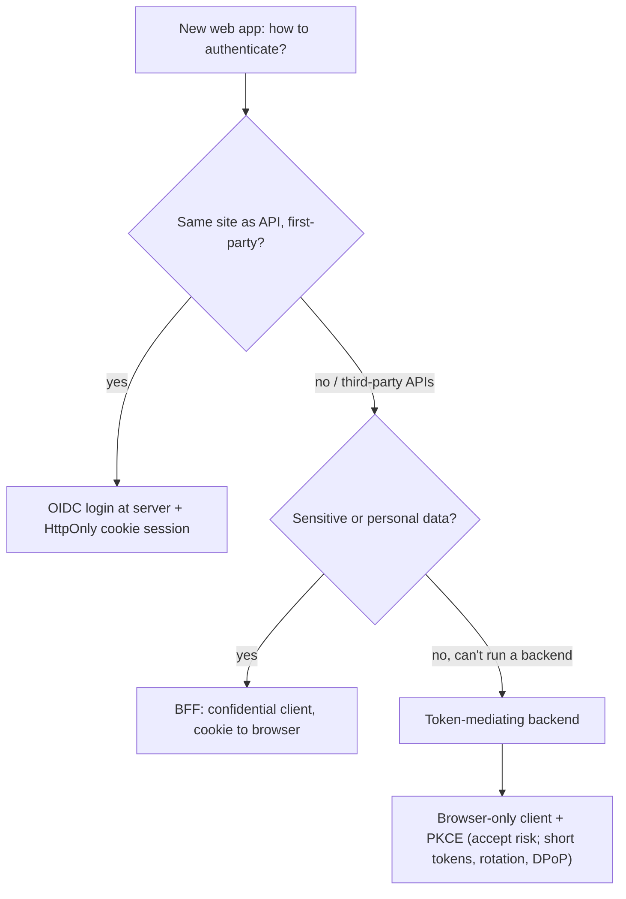
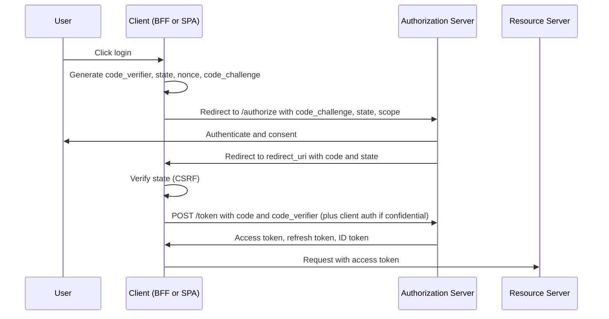
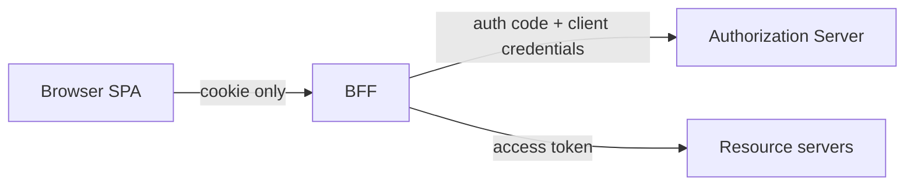
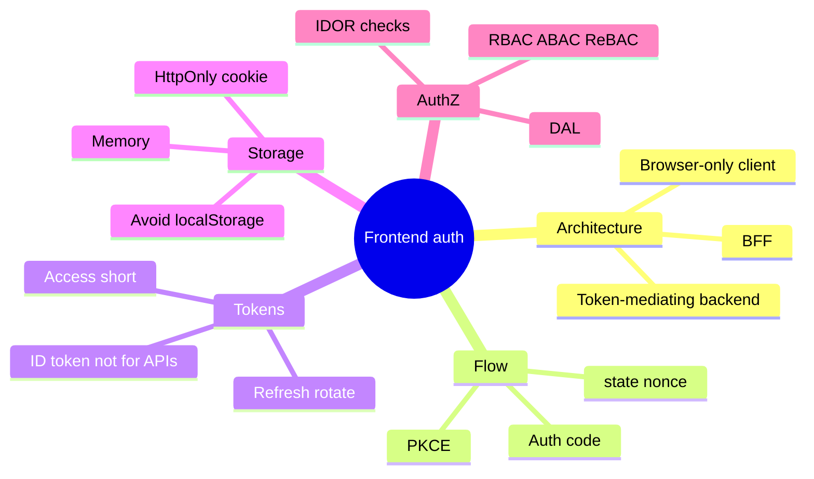

# Authentication and Authorization in the Frontend

> Verification note: OAuth/OIDC browser guidance was verified against **IETF RFC 10017 "OAuth 2.0 for Browser-Based Applications" (BCP 212, Aug 2026)**, which builds on RFC 9700 (OAuth Security BCP, Jan 2025): Authorization Code + PKCE only; Implicit and Resource Owner Password Credentials grants must not be used; architecture patterns BFF > token-mediating backend > browser-only client; token storage, refresh-token rules, DPoP limits, cookie rules for BFFs. Cookie attribute facts are from MDN (Sep 2026). Next.js Data Access Layer / Server Function authorisation guidance is from nextjs.org docs researched earlier. Not re-verified and marked *(hedged)*: WebAuthn/passkey browser details, OIDC logout variants, specific IdP library behaviours, mobile (React Native) storage APIs, token-lifetime recommendations, rate-limit numbers.

## Table of Contents

1. [Quick Summary (TL;DR)](#1-quick-summary-tldr)
2. [AuthN vs AuthZ and the Vocabulary](#2-authn-vs-authz-and-the-vocabulary)
3. [Choosing an Architecture (RFC 10017 Patterns)](#3-choosing-an-architecture-rfc-10017-patterns)
4. [Authorization Code Flow with PKCE](#4-authorization-code-flow-with-pkce)
5. [Backend for Frontend (BFF) in Detail](#5-backend-for-frontend-bff-in-detail)
6. [Tokens: Access, Refresh, ID, JWT](#6-tokens-access-refresh-id-jwt)
7. [Token Storage in the Browser](#7-token-storage-in-the-browser)
8. [Refresh, Silent Auth and Logout](#8-refresh-silent-auth-and-logout)
9. [Authorization: Where and How to Enforce](#9-authorization-where-and-how-to-enforce)
10. [Authorization in React, Next.js and APIs](#10-authorization-in-react-nextjs-and-apis)
11. [Passwords, MFA and Passkeys](#11-passwords-mfa-and-passkeys)
12. [Account Abuse: Brute Force, Enumeration, Bots](#12-account-abuse-brute-force-enumeration-bots)
13. [Mobile and React Native Notes](#13-mobile-and-react-native-notes)
14. [Pitfalls](#14-pitfalls)
15. [Interview Questions — Fundamentals](#15-interview-questions--fundamentals)
16. [Interview Questions — Senior Scenarios](#16-interview-questions--senior-scenarios)
17. [Cheat Sheet](#17-cheat-sheet)
18. [Key Terms Glossary](#18-key-terms-glossary)
19. [Further Reading](#19-further-reading)

---

## 1. Quick Summary (TL;DR)

- **Authentication (AuthN)** = who are you; **Authorization (AuthZ)** = what may you do. Frontend code can *display* both; only servers can *enforce* them.
- **RFC 10017 (Aug 2026) current practice:** use the **Authorization Code grant with PKCE**; **never** the Implicit grant or ROPC (password) grant. Three architectures in **decreasing security**:
  1. **BFF (Backend for Frontend)** — a server-side confidential client holds the tokens; the browser only has an `HttpOnly` session cookie. **Strongly recommended for business, sensitive and personal-data apps.**
  2. **Token-mediating backend** — backend gets tokens (holds refresh token), hands the access token to JS; access token theft still possible.
  3. **Browser-only OAuth client** — public client in JS; **not recommended** for business/sensitive/personal-data apps.
- **Why this ranking:** if XSS occurs, a malicious script can steal tokens, persistently steal refreshed tokens, **run a new silent auth-code flow in a hidden iframe** to mint fresh tokens, or simply proxy requests through the user's browser. A BFF defeats the first three; the last is inherent to any web app.
- **Same-domain first-party apps often don't need OAuth at all:** OIDC login + server-side cookie session is simpler (RFC 10017 §7.1).
- **Never put authorisation only in the UI.** Enforce per request, per object, on the server; test negative cases.
- **Prefer passkeys/WebAuthn + MFA** *(hedged)*, rate limiting, and generic errors; never roll your own crypto or password storage.



---

## 2. AuthN vs AuthZ and the Vocabulary

| Term | Meaning |
|---|---|
| **Authentication** | Proving identity (password, passkey, SSO) |
| **Authorization** | Deciding permissions for an authenticated identity |
| **Session** | Server-tracked authenticated state, usually referenced by a cookie |
| **OAuth 2.0** | Delegated **authorization** framework (access tokens for APIs) |
| **OpenID Connect (OIDC)** | Identity layer on OAuth 2.0: **ID token** (who the user is), `openid` scope, UserInfo |
| **Access token** | Credential presented to a resource server (API) |
| **Refresh token** | Credential to obtain new access tokens |
| **ID token** | JWT for the *client* describing authentication; **not** for calling APIs |
| **PKCE** | Proof Key for Code Exchange (RFC 7636); binds the code exchange to the client instance that started the flow |
| **DPoP** | Demonstrating Proof-of-Possession (RFC 9449): sender-constrains tokens to a key |
| **Confidential vs public client** | Can vs can't keep a secret (BFF = confidential; SPA = public) |
| **Scopes / audiences** | Limit what a token can do / which API it is for (RFC 8707 resource indicators) |

---

## 3. Choosing an Architecture (RFC 10017 Patterns)

| Pattern | Who holds tokens | Browser has | Resists | Remaining risk | Use when |
|---|---|---|---|---|---|
| **A. Same-domain, no OAuth** (OIDC login + session cookie) | Server session | HttpOnly cookie | Token theft (none to steal) | Client hijacking (XSS proxying), CSRF | First-party app and API on one site |
| **B. BFF** | BFF (server) | HttpOnly cookie | Token theft, persistent theft, new-token minting | Client hijacking; BFF is a high-value target; CSRF on BFF | **Default for sensitive/enterprise apps** |
| **C. Token-mediating backend** | Refresh token on backend; access token in JS | Cookie + access token in memory | Refresh token theft, new-token minting | Access token theft + abuse; proxying | Direct-to-API calls needed, can't proxy |
| **D. Browser-only OAuth client** | Browser (memory/storage) | Access + refresh tokens | Little | All four XSS scenarios | Low-risk apps, no backend; add DPoP/rotation |
| **E. Service-worker OAuth** | SW memory | — | — | Attacker unregisters SW then runs a flow (RFC: **not recommended**) | Avoid |
| **F. Implicit / ROPC** | — | — | — | Token in URL/history; password handling | **Must not be used** |

**Interview line:** *"Because malicious JS has the same privileges as the app, the architecture decides the blast radius — BFF keeps tokens out of JS entirely."*

---

## 4. Authorization Code Flow with PKCE


Rules (RFC 10017/9700):
- **Public browser clients MUST use PKCE**, and authorisation servers must enforce it for them.
- **Exact redirect URI matching** (no wildcards/patterns); register only HTTPS URIs.
- **CSRF on the redirect URI:** PKCE, or a unique `state` (verified) or OIDC `nonce`.
- **Remove the `code` from the URL** after the exchange (`history.replaceState`) to avoid leakage.
- **No client secrets in SPAs** — they aren't secrets (authorisation servers must not rely on shared secrets for SPA clients).
- When using popups/iframes, communicate via `postMessage` and verify **both** origins.
- **Mix-up attacks:** with multiple authorisation servers, validate the issuer (`iss`) — RFC 9700 *(per RFC 10017 §9.3)*.

---

## 5. Backend for Frontend (BFF) in Detail

**Responsibilities (RFC 10017 §6.1):** (1) act as a **confidential OAuth client**, (2) keep tokens in a **cookie-based session**, never expose them to the browser, (3) **forward API requests**, attaching the access token.



**Endpoints:** `/bff/session` (check session / user info), `/bff/login` (start flow, redirect), `/bff/callback` (receive code), `/bff/logout`, plus a proxy (`/bff/api/*`).

**Security requirements (verified from RFC 10017 §6.1.3):**
- Cookie: **Secure (MUST), HttpOnly (MUST), SameSite=Strict (SHOULD), `Path=/` (SHOULD), no `Domain` (SHOULD), `__Host-Http-` prefix (SHOULD)**; encrypt cookie contents if the session is client-side and contains tokens.
- **CSRF defence is mandatory:** SameSite=Strict is insufficient if other apps share the site (subdomain takeover) → require a **custom request header** (forces preflight; CORS blocks cross-origin) and/or double-submit tokens ([04](04-cookies-sessions-and-csrf.md)).
- **Proxy restrictions:** **allow-list outbound hosts/paths and methods** per route so attackers can't steer the BFF to leak the user's access token to arbitrary servers.
- **Refresh handling:** BFF refreshes tokens as a confidential client; session lifetime ≈ refresh-token lifetime; invalidate the session when the refresh token is rejected.
- **Operational:** rate limiting at the API sees one BFF IP — propagate client IP/user identity for anti-abuse; BFF sees all traffic (privacy: avoid third-party-hosted BFFs for sensitive data).
- **Advanced:** private-key JWT client authentication, DPoP/mTLS-bound tokens are easier server-side.

```ts
// Minimal BFF proxy route (Node/Express sketch)
const ROUTES = new Map([['/orders', 'https://orders.internal.example.com'], ['/profile', 'https://profile.internal.example.com']]);

app.use('/bff/api/:svc/*', requireSession, requireCsrfHeader, async (req, res) => {
  const base = ROUTES.get(`/${req.params.svc}`);
  if (!base || !ALLOWED_METHODS[req.params.svc]?.includes(req.method)) return res.sendStatus(404);
  const token = await getFreshAccessToken(req.session);           // refresh server-side if needed
  const upstream = await fetch(new URL(req.params[0], base), {    // path validated; host fixed
    method: req.method, headers: { Authorization: `Bearer ${token}`, 'Content-Type': req.get('Content-Type') ?? 'application/json' },
    body: ['GET', 'HEAD'].includes(req.method) ? undefined : JSON.stringify(req.body),
  });
  res.status(upstream.status).set('Content-Type', upstream.headers.get('Content-Type') ?? 'application/json');
  res.send(Buffer.from(await upstream.arrayBuffer()));
});
```
*(Illustrative; production code needs path normalisation, size/time limits, header allow-lists and error handling — [08](08-secure-frontend-patterns-and-vulnerability-catalogue.md) on SSRF.)*

---

## 6. Tokens: Access, Refresh, ID, JWT

- **Reduce token authority (RFC 10017 §9.1):** short access-token lifetime, minimal **scopes**, restrict to one resource via **resource indicators (RFC 8707)**, avoid unneeded ID-token claims.
- **Refresh tokens for browser clients (RFC 10017/9700 MUSTs):** must be **rotated on every use or sender-constrained**; must have a **maximum lifetime or expire on inactivity**; rotation must not extend the overall lifetime; should be tied to the user's session at the authorisation server so logout invalidates them.
- **Limits of rotation:** persistent token theft defeats rotation (attacker keeps the latest token; the legitimate app simply never uses a stale one — RFC 10017 §5.1.2).
- **JWT facts:**
  - A JWT is **signed, not encrypted** (JWS) by default — don't put secrets in it; anyone can decode it.
  - **Validate on the resource server:** signature (pin algorithm; reject `none`), `iss`, `aud`, `exp`/`nbf`, `alg` allow-list, key rotation via JWKS.
  - **Revocation** is hard for stateless tokens → short TTLs + refresh checks, denylists, or reference tokens/introspection.
  - Don't use ID tokens as API credentials; don't trust client-decoded claims for authorisation decisions.
- **Opaque vs JWT access tokens:** opaque reduces information leakage and enables immediate revocation via introspection; JWT enables local validation.
- **DPoP (RFC 9449):** binds tokens to a (non-extractable) key so stolen tokens alone are unusable; it does **not** stop an attacker who runs a **new flow** and binds fresh tokens to their own key, and it **does not stop request proxying** (RFC 10017 §5, §6.3.4.2.2).

---

## 7. Token Storage in the Browser

RFC 10017 §8 summary and my guidance:

| Storage | XSS can read? | Notes |
|---|---|---|
| **HttpOnly cookie (BFF session)** | No | Best for first-party; needs CSRF defences |
| **JS-readable cookie as token store** | Yes | **NOT RECOMMENDED** (sent to your server on every request) |
| **In-memory variable/closure** | Yes (attacker can call functions; **prototype poisoning** can leak closure arguments) | No persistence across reloads; limited exposure window |
| **Web Worker / Service Worker memory** | Not directly | Isolates **refresh token**; attacker can still call the worker to get access tokens or run a new flow; SW must not persist tokens in IndexedDB (shared with window) |
| **`sessionStorage`** | Yes | Per-tab; slightly smaller exposure; sync API |
| **`localStorage`** | **Yes** | Persistent, origin-wide, synchronous — **avoid for tokens** |
| **IndexedDB** | Yes | Async, shared with SW; fine for **non-extractable CryptoKeys** (DPoP) |

Additional notes: no guarantee browser storage is **encrypted at rest** (malware can read profiles); Web Crypto non-extractable keys prevent JS exfiltration but don't guarantee TPM-backed storage; **even perfect storage can't stop "acquire new tokens" XSS** (the attacker runs their own flow).

**Practical guidance:**
1. Choose BFF if you can.
2. Otherwise: access token in memory only; refresh via a worker or backend; short TTLs; rotation; DPoP where supported.
3. Isolate **one app per origin** (RFC 10017 §9.4) to benefit from SOP/CSP/CORS.
4. Keep XSS prevention first-class ([02](02-xss-trusted-types-and-sanitization.md), [03](03-content-security-policy-in-depth.md)).

---

## 8. Refresh, Silent Auth and Logout

- **Silent auth via hidden iframe (`prompt=none`)** depends on third-party cookies and is increasingly blocked; RFC 10017 notes third-party cookie blocking makes refresh tokens more attractive for browser clients. With a BFF, refresh happens server-side.
- **Handling 401s:** central API client; single-flight refresh (avoid refresh stampedes); queue requests during refresh; on failure redirect to login with a safe `returnTo` (validate — open redirect, [08](08-secure-frontend-patterns-and-vulnerability-catalogue.md)).
- **Logout layers:**
  1. Clear local app state and caches.
  2. Invalidate the **server session** and revoke refresh/access tokens at the AS (token revocation endpoint).
  3. **RP-initiated logout** at the IdP (OIDC) to end SSO session *(hedged variants: front-channel, back-channel logout)*.
  4. Broadcast logout to other tabs (`BroadcastChannel`); consider **bfcache** restoring pages after logout ([web-performance/03](../web-performance/03-network-caching-and-delivery.md): refresh stale/sensitive data on `pageshow` with `persisted`).
- **Session expiry UX:** warn before expiry; preserve unsaved work; re-auth modals must not leak into URLs.
- **Step-up authentication:** require recent re-auth/MFA (`acr`/`auth_time` claims *(hedged)*) for sensitive operations.

---

## 9. Authorization: Where and How to Enforce

### The cardinal rules
1. **Enforce on the server for every request** (API, Server Action, route handler, GraphQL resolver, WebSocket message).
2. **Check object-level permissions** (is this order yours?) — prevents **IDOR/BOLA**.
3. **Check function-level permissions** (can this role call this endpoint?) — prevents **BFLA** *(API Security terms; hedged)*.
4. **Check property-level permissions** (don't return/accept fields the caller shouldn't see/set → mass assignment) *(hedged)*.
5. **Default deny**; centralise policy (policy engine, DAL, middleware) and test it.

### Models
| Model | Idea | Example |
|---|---|---|
| **RBAC** | Roles → permissions | `admin`, `editor` |
| **ABAC** | Attributes of subject/resource/context | `user.dept == doc.dept && doc.status != 'locked'` |
| **ReBAC** | Relationships (graph) | "viewer of folder → can view docs inside" |
| **Policy engines** *(hedged)* | OPA/Cedar/Zanzibar-style stores | Central decisions, auditable |

### What the frontend does
- **Render based on server-provided capabilities** (`can: { edit: true }`) to hide/disable UI; treat as UX hints.
- **Don't embed role names as security logic** in client code that must be trusted.
- **Handle 401/403 gracefully**: login redirect vs "forbidden" screen; avoid leaking existence of resources (404 vs 403 policy).
- **Never trust claims decoded client-side** for gating sensitive data.

```ts
// Server-side authorization helper (Data Access Layer pattern)
export async function getInvoice(user: SessionUser, id: string) {
  const invoice = await db.invoice.findUnique({ where: { id } });
  if (!invoice) return null;                                   // or throw NotFound
  if (invoice.tenantId !== user.tenantId) return null;          // tenant isolation (object-level)
  if (!hasPermission(user, 'invoice:read', invoice)) throw new Forbidden();
  return toDTO(invoice);                                        // return only needed fields (property-level)
}
```

---

## 10. Authorization in React, Next.js and APIs

*(Next.js specifics from docs researched earlier — see [nextjs-and-rendering/06](../nextjs-and-rendering/06-proxy-auth-and-security.md).)*

- **Route guards in React Router/Next layouts are UX.** Layouts don't re-run on every client navigation in the App Router, so **don't rely on layout checks for authorisation** — check in the page/DAL where data is fetched.
- **Server Functions (Server Actions) are public HTTP endpoints** reachable via direct POST: **authenticate and authorise inside every function**, validate inputs, check object ownership; a page-level check does not cover the action.
- **Data Access Layer (DAL):** one `server-only` module that reads the session, authorises, and returns **DTOs**; components never call the database directly; use `React.cache` to dedupe `getCurrentUser()` per request.
- **`proxy.ts` (formerly middleware)** is for optimistic redirects, not a sole auth boundary; it runs only on matched paths (and excluded matchers skip Server Function POSTs to those routes) — **don't use it as the only check**.
- **Server Components** can read cookies/session safely, but props passed to Client Components are serialised to the browser — **don't pass secrets or full DB rows**; consider Taint APIs *(experimental)*.
- **Environment variables:** only `NEXT_PUBLIC_*` reach the client; keep API keys server-side; read process.env only in the DAL.
- **Route handlers (`app/api/*`)** need the same authz as any API; CSRF applies for cookie-authenticated mutation handlers.
- **GraphQL:** authorise at resolver/field level, limit depth/complexity, disable introspection in prod where appropriate *(hedged)*, persisted queries.
- **Multi-tenant SaaS:** enforce tenant ID in every query (row-level security in the database *(hedged)*), include tenant in cache keys (CDN/React Query/`use cache`) to avoid cross-tenant leakage.

### Caching and personalisation hazards
- **CDN/shared caches must not cache authenticated responses** unless `Vary`/`private`/`no-store` is correct; cache poisoning/deception (e.g., `/account.css` path confusion *(hedged)*) can expose user data ([06](06-security-headers-cors-and-transport.md)).
- Client caches (React Query/SWR) must be **cleared on logout or user switch**.

---

## 11. Passwords, MFA and Passkeys

- **Passwords:** server-side hashing with a modern slow hash (Argon2id/bcrypt/scrypt *(hedged: follow OWASP guidance)*); allow long passphrases and password managers (`autocomplete="current-password"`/`"new-password"`, paste allowed); **don't hash on the client as a substitute** for TLS + server hashing; check breached-password lists; no composition-rule theatre.
- **MFA:** TOTP/push/SMS (SMS weakest); **phishing-resistant** options (WebAuthn) for high-risk users; recovery flows are the weak link — design carefully.
- **Passkeys / WebAuthn** *(hedged on browser details)*: public-key credentials bound to the **origin (RP ID)**, resistant to phishing and credential stuffing; `navigator.credentials.create/get` with server-generated challenge; conditional UI (autofill) for sign-in; store only public keys server-side; plan fallback and account recovery.
- **Magic links/OTP:** short expiry, single-use, rate limits, bind to device/session where feasible; prevent open redirects in links.
- **Account recovery:** avoid knowledge-based questions; notify users of changes; require re-auth for email/phone changes.
- **Session binding & step-up** for sensitive operations (payments, credential changes).

---

## 12. Account Abuse: Brute Force, Enumeration, Bots

| Threat | Mitigation |
|---|---|
| **Credential stuffing/brute force** | Rate limits (IP, account, device), progressive delays, MFA, breached-password checks, bot detection/CAPTCHA, anomaly alerts |
| **Account enumeration** | Same response/timing for "user exists" vs not on login/reset/registration; generic messages |
| **Password reset abuse** | Single-use, short-lived tokens; don't leak whether email exists; invalidate on use/password change; rate limit |
| **Session hijacking** | HttpOnly/Secure cookies, rotation, device/anomaly checks |
| **OAuth abuse** | Exact redirect URIs, PKCE, state/nonce checks, consent screens, scope minimisation |
| **Scraping/automation** | Rate limits, behavioural signals, tokens bound to sessions |

Rate limiting belongs on the **server/edge**; client-side throttling is UX only.

---

## 13. Mobile and React Native Notes

*(Hedged — general guidance; see RFC 8252/BCP 212 referenced by RFC 10017 for native apps.)*
- Use the **system browser** (ASWebAuthenticationSession/Custom Tabs) for the Authorization Code + PKCE flow, not embedded WebViews.
- Store tokens in **Keychain/Keystore** (secure storage libraries), not AsyncStorage/MMKV in plaintext; use biometric gating where appropriate.
- Verify **redirect handling** (universal/app links) to prevent interception; certificate pinning is a trade-off (outages, rotation).
- WebView-based hybrid pieces re-introduce XSS/SOP considerations — restrict navigation and bridge exposure ([react-native/03](../react-native/03-native-integration.md)).

---

## 14. Pitfalls

1. **Using the Implicit grant or ROPC** (explicitly disallowed by RFC 10017).
2. **Access/refresh tokens in `localStorage`** in sensitive apps.
3. **Treating JWT decoding on the client as authorisation.**
4. **No PKCE / no `state` check / loose redirect URI matching.**
5. **Rotation without maximum lifetime**, or rotation relied upon against persistent XSS theft.
6. **BFF as an open proxy** (no host/path allow-list) leaking tokens.
7. **Layout/route-level guards as the only authz** (Next.js layouts don't re-run on every navigation).
8. **Server Actions without authz/ownership checks.**
9. **Caching authenticated responses at CDN/shared caches** or not clearing client caches on logout.
10. **Verbose auth errors / enumeration.**
11. **Long-lived sessions without server-side revocation.**
12. **Client secrets in SPA bundles.**
13. **Trusting `window.opener`/postMessage during popup logins without origin checks.**
14. **Forgetting bfcache/back-button after logout.**

---

## 15. Interview Questions — Fundamentals

### Q1. Authentication vs authorization?
Authentication verifies identity; authorization decides what that identity may do. Enforce both server-side.

### Q2. Which OAuth flow should an SPA use and why?
Authorization Code with PKCE; the Implicit grant exposes tokens in URLs/history and is no longer allowed by current guidance (RFC 10017), and ROPC must not be used.

### Q3. What does PKCE protect against?
Authorization code interception/injection by binding the code exchange to the client that initiated the flow via a one-time `code_verifier`/`code_challenge`.

### Q4. Why shouldn't you store tokens in `localStorage`?
Any XSS (or malicious script in the origin) can read it synchronously and exfiltrate it; it persists and is shared across tabs.

### Q5. What is a BFF?
A server-side component of the frontend app that acts as the OAuth confidential client, keeps tokens server-side tied to a cookie session, and proxies API calls.

### Q6. Access token vs ID token?
Access tokens authorise API calls; ID tokens (OIDC) describe the authentication event/user to the client and shouldn't be sent to APIs as credentials.

### Q7. What must you validate on a JWT?
Signature (with an allow-listed algorithm), issuer, audience, expiry/not-before, and any required claims; reject `alg: none`.

### Q8. What is IDOR?
An object-level authorization failure where changing an identifier lets a user access others' data.

### Q9. Why are refresh tokens riskier in browsers?
They are bearer credentials that grant long-term access; stolen tokens can be used without detection unless rotation/sender-constraint and lifetime limits apply (and persistent XSS theft defeats rotation).

---

## 16. Interview Questions — Senior Scenarios

### S1. "Our SPA stores access and refresh tokens in localStorage; pen test says XSS = account takeover. What do we do?"
Short term: reduce token lifetimes, enable refresh rotation + max lifetime, tighten CSP/Trusted Types, remove third-party scripts. Medium term: move to a **BFF** (HttpOnly `__Host-Http-` cookie, server-held tokens, CSRF header, outbound allow-list). If not possible: token-mediating backend with access token in memory + DPoP. Explain that the "new token via hidden iframe" scenario is why storage tweaks alone aren't enough (RFC 10017 §5.1.3).

### S2. "Design SSO across 5 internal apps on different subdomains."
Central IdP with OIDC; each app as BFF/confidential client or server-rendered with its own host-only cookie (`__Host-`), avoid sharing parent-domain session cookies; consistent logout (front/back-channel) *(hedged)*; one app per origin; scope-limited tokens per app; centralised MFA/step-up; handle third-party-cookie blocking by using top-level redirects.

### S3. "A Server Action `deleteProject(id)` only checks that the user is logged in. What's wrong?"
It's a public POST endpoint; missing object-level authorisation allows IDOR — any logged-in user can delete any project by changing `id`. Verify ownership/role inside the action (preferably via a DAL helper), validate input with a schema, enforce CSRF/origin protections (framework Origin check + token as needed), audit-log the deletion and add negative tests.

### S4. "Multi-tenant dashboard leaks data between tenants intermittently."
Likely caching or missing tenant scoping: check CDN/Next/`use cache`/React Query keys for tenant/user inclusion, `Cache-Control`/`Vary` for authenticated responses, shared singleton state on the server (module-level variables in SSR), database queries missing tenant filters (use row-level security), logging to detect cross-tenant access; write regression tests with two tenants.

### S5. "Explain why DPoP doesn't solve XSS token theft entirely."
DPoP binds tokens to a non-extractable key, so exfiltrated tokens aren't usable elsewhere, but an XSS attacker running in the origin can use the browser's own key via the app (proxying), or run a new authorisation flow and bind the new tokens to the attacker's key; RFC 10017 explicitly notes these limits.

### S6. "How do you handle token refresh in a React app without race conditions?"
Single-flight refresh promise shared across requests, retry once after refresh, queue concurrent 401 responses, abort on logout, handle refresh failure by clearing state and redirecting with a validated `returnTo`; with a BFF, refresh is server-side so the client just retries once on 401.

---

## 17. Cheat Sheet

| Decision | Choose |
|---|---|
| Grant | Authorization Code + PKCE |
| Sensitive web app | BFF + `__Host-Http-` cookie |
| Tokens in browser | Memory only (if unavoidable) |
| Refresh tokens | Rotate or sender-constrain + max lifetime |
| AuthZ | Server, per object, default deny |
| UI gating | UX only |
| Next.js | Check in DAL/Server Actions, not only layouts/proxy |
| Logout | Clear client + server session + revoke + IdP logout + other tabs |



---

## 18. Key Terms Glossary

| Term | Definition |
|---|---|
| **BFF** | Server-side frontend component acting as OAuth client and proxy |
| **PKCE** | Code-exchange proof preventing code interception |
| **DPoP** | Proof-of-possession binding of tokens to keys |
| **Token mediating backend** | Backend that obtains tokens and passes the access token to JS |
| **IDOR/BOLA** | Missing object-level authorization |
| **RBAC/ABAC/ReBAC** | Role / attribute / relationship-based access control |
| **Passkey** | WebAuthn discoverable credential |
| **DAL** | Data Access Layer enforcing authz and DTOs |

---

## 19. Further Reading

- [IETF RFC 10017 — OAuth 2.0 for Browser-Based Applications (BCP 212)](https://datatracker.ietf.org/doc/rfc10017/) · [RFC 9700 — OAuth 2.0 Security BCP](https://www.rfc-editor.org/info/rfc9700) · [RFC 9449 — DPoP](https://www.rfc-editor.org/info/rfc9449) · [RFC 7636 — PKCE](https://www.rfc-editor.org/info/rfc7636)
- [OWASP Authentication](https://cheatsheetseries.owasp.org/cheatsheets/Authentication_Cheat_Sheet.html) · [Authorization](https://cheatsheetseries.owasp.org/cheatsheets/Authorization_Cheat_Sheet.html) · [JWT](https://cheatsheetseries.owasp.org/cheatsheets/JSON_Web_Token_for_Java_Cheat_Sheet.html) cheat sheets
- This repo: [04 Cookies, sessions and CSRF](04-cookies-sessions-and-csrf.md) · [nextjs-and-rendering/06 Proxy, auth and security](../nextjs-and-rendering/06-proxy-auth-and-security.md) · [browser-internals/06 §13 Auth flows](../browser-internals/06-browser-security-model.md#13-auth-flows-in-the-browser-cookies-tokens-oauthoidc)
