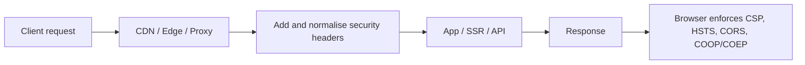
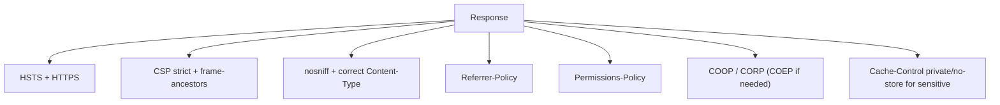

# Security Headers, CORS and Transport Security

> Verification note: CSP-related headers (`frame-ancestors`, `upgrade-insecure-requests`, `Reporting-Endpoints`), `Clear-Site-Data: "cookies"`, cookie prefixes, and same-origin/cross-origin behaviour were verified against MDN (CSP guide Mar 2026, Cookies Sep 2026) and, for browser storage/same-origin facts, earlier research in this handbook. CORS mechanics, HSTS preload requirements, `Referrer-Policy` values, `Permissions-Policy` syntax, COOP/COEP/CORP, `X-Content-Type-Options`, SRI and cache-related headers are standards-level knowledge **not re-fetched** in this session and are marked *(hedged)* where numbers or support matter. Header support and defaults evolve — validate with MDN and a scanner before shipping. Browser-level explanations: [browser-internals/06 §4, §10–§12](../browser-internals/06-browser-security-model.md).

## Table of Contents

1. [Quick Summary (TL;DR)](#1-quick-summary-tldr)
2. [Baseline Header Set](#2-baseline-header-set)
3. [Where to Set Headers](#3-where-to-set-headers)
4. [CORS: Correct Configuration and Common Mistakes](#4-cors-correct-configuration-and-common-mistakes)
5. [HTTPS, HSTS and Mixed Content](#5-https-hsts-and-mixed-content)
6. [Referrer-Policy and Information Leakage](#6-referrer-policy-and-information-leakage)
7. [Permissions-Policy and Feature Control](#7-permissions-policy-and-feature-control)
8. [Isolation Headers: COOP, COEP, CORP](#8-isolation-headers-coop-coep-corp)
9. [MIME Sniffing, Downloads and Uploaded Content](#9-mime-sniffing-downloads-and-uploaded-content)
10. [Caching and Sensitive Responses](#10-caching-and-sensitive-responses)
11. [Subresource Integrity and Framing](#11-subresource-integrity-and-framing)
12. [Testing, Monitoring and Rollout](#12-testing-monitoring-and-rollout)
13. [Pitfalls](#13-pitfalls)
14. [Interview Questions — Fundamentals](#14-interview-questions--fundamentals)
15. [Interview Questions — Senior Scenarios](#15-interview-questions--senior-scenarios)
16. [Cheat Sheet](#16-cheat-sheet)
17. [Key Terms Glossary](#17-key-terms-glossary)
18. [Further Reading](#18-further-reading)

---

## 1. Quick Summary (TL;DR)

- **Security headers are cheap, high-leverage hardening** applied centrally (CDN/edge/reverse proxy/framework). They are **defence in depth**, not substitutes for secure code.
- **Baseline:** `Strict-Transport-Security`, `Content-Security-Policy` (+ `frame-ancestors`), `X-Content-Type-Options: nosniff`, `Referrer-Policy`, `Permissions-Policy`, correct `Cache-Control` for sensitive pages, cookie flags, and COOP/COEP/CORP where cross-origin isolation or Spectre-class isolation is needed.
- **CORS** is a *relaxation* of the same-origin policy for **reads**; it is browser-enforced, does not authenticate callers, and does not protect servers from non-browser clients or CSRF. The dangerous patterns: **reflecting `Origin`**, allowing **`null`**, **wildcards with credentials**, or loose regex matches.
- **HTTPS everywhere + HSTS** prevent downgrade and cookie leakage; **`upgrade-insecure-requests`** helps migrations but is **not a substitute for HSTS** (MDN).
- **Referrer and URL hygiene:** never put secrets in URLs; set `Referrer-Policy` to limit leakage.
- **Test headers in CI** and monitor with report endpoints; roll out CSP via report-only.



---

## 2. Baseline Header Set

| Header | Typical value | Purpose |
|---|---|---|
| **`Strict-Transport-Security`** | `max-age=31536000; includeSubDomains; preload` *(preload only after readiness)* | Force HTTPS on future visits |
| **`Content-Security-Policy`** | Nonce/hash strict CSP ([03](03-content-security-policy-in-depth.md)) | Mitigate XSS, framing, exfil |
| **`X-Content-Type-Options`** | `nosniff` | Stop MIME sniffing (script/style content-type confusion) |
| **`Referrer-Policy`** | `strict-origin-when-cross-origin` (common default) or stricter | Limit URL leakage |
| **`Permissions-Policy`** | `camera=(), microphone=(), geolocation=(), payment=(self)` *(tailor)* | Restrict powerful features (also for embedded frames) |
| **`Cross-Origin-Opener-Policy`** | `same-origin` (when no cross-window needs) | Isolate browsing context group; enable cross-origin isolation |
| **`Cross-Origin-Embedder-Policy`** | `require-corp` or `credentialless` | Require opt-in for embedded cross-origin resources |
| **`Cross-Origin-Resource-Policy`** | `same-origin` / `same-site` / `cross-origin` | Control who may load your resources |
| **`X-Frame-Options`** | `DENY`/`SAMEORIGIN` (legacy; prefer CSP `frame-ancestors`) | Clickjacking |
| **`Cache-Control`** | `no-store` / `private, no-cache` for sensitive pages | Avoid shared-cache/bfcache/disk leaks |
| **`Set-Cookie` flags** | `__Host-…; Secure; HttpOnly; SameSite` ([04](04-cookies-sessions-and-csrf.md)) | Session protection |
| **`Reporting-Endpoints`** | `csp="https://reports.example.com/csp"` | Receive CSP/other reports (verified, MDN) |
| **`Clear-Site-Data`** | `"cookies", "storage", "cache"` on logout *(use deliberately)* | Clear state (verified for `"cookies"`) |
| **`X-XSS-Protection`** | Omit or `0` | Legacy filter removed/unsafe; rely on CSP *(hedged)* |
| **`Server`/`X-Powered-By`** | Remove/minimise | Reduce fingerprinting (minor) |

> **Legacy note:** `X-Frame-Options` is superseded by `frame-ancestors` (MDN), but keeping both is common for older clients. `Public-Key-Pins`/`Expect-CT` are obsolete *(hedged)*.

---

## 3. Where to Set Headers

| Layer | Pros | Cons |
|---|---|---|
| **CDN/edge/WAF** (CloudFront functions, Fastly, Cloudflare Workers) | Covers static assets, uniform, fast rollout | Per-request nonces require edge logic; config drift from app |
| **Reverse proxy** (nginx/Envoy) | Central, language-agnostic | Needs `always` semantics to cover error responses |
| **Framework** (Next.js `headers()`/proxy, Express `helmet`) | Close to app logic (nonces, route-specific) | Misses assets served elsewhere |
| **Static hosting config** (`_headers`, `vercel.json`, S3+CloudFront) | Simple for SPAs | Limited dynamism |

Next.js static headers example *(hedged: verify current API)*:
```js
// next.config.js
const securityHeaders = [
  { key: 'Strict-Transport-Security', value: 'max-age=31536000; includeSubDomains' },
  { key: 'X-Content-Type-Options', value: 'nosniff' },
  { key: 'Referrer-Policy', value: 'strict-origin-when-cross-origin' },
  { key: 'Permissions-Policy', value: 'camera=(), microphone=(), geolocation=()' },
  { key: 'Content-Security-Policy', value: "frame-ancestors 'none'; base-uri 'none'; object-src 'none'" },
];
module.exports = { async headers() { return [{ source: '/:path*', headers: securityHeaders }]; } };
```
- The **nonce-based script CSP** must be generated per request (proxy/middleware) — see [03 §8](03-content-security-policy-in-depth.md#8-csp-in-react-nextjs-and-spas).
- Apply headers to **all** responses, including 404/500, redirects, API routes and static files (MDN: CSP "should be set on all responses").
- Multiple layers adding the same header can produce **duplicates/conflicts** — decide a single owner per header.

---

## 4. CORS: Correct Configuration and Common Mistakes

### Mechanics recap *(hedged where noted)*
- Browser sends `Origin` on cross-origin requests; the server may respond with `Access-Control-Allow-Origin` (ACAO) to let scripts **read** the response.
- **Simple (safelisted) requests** are sent without preflight; the browser then blocks reading unless ACAO matches. **Non-simple** requests (custom headers, JSON `Content-Type`, `PUT/DELETE`) trigger an **`OPTIONS` preflight** with `Access-Control-Request-Method/Headers`; the server answers with `Access-Control-Allow-Methods/Headers` and optionally `Access-Control-Max-Age` (browser caps apply *(hedged)*).
- **Credentials** (`credentials: 'include'`) require `Access-Control-Allow-Credentials: true` **and** a specific origin (no `*`).
- **`Vary: Origin`** is required whenever ACAO is dynamic, to prevent caches serving the wrong origin's response.
- Expose non-safelisted response headers via `Access-Control-Expose-Headers`.

### Correct pattern
```ts
const ALLOWED = new Set(['https://app.example.com', 'https://admin.example.com']);

function cors(req, res, next) {
  const origin = req.get('Origin');
  if (origin && ALLOWED.has(origin)) {                         // exact match against an allow-list
    res.set('Access-Control-Allow-Origin', origin);
    res.set('Access-Control-Allow-Credentials', 'true');
    res.append('Vary', 'Origin');
  }
  if (req.method === 'OPTIONS') {
    res.set('Access-Control-Allow-Methods', 'GET,POST,PUT,DELETE');
    res.set('Access-Control-Allow-Headers', 'Content-Type, X-CSRF-Token');
    res.set('Access-Control-Max-Age', '600');
    return res.sendStatus(204);
  }
  next();
}
```

### Common mistakes
| Mistake | Risk |
|---|---|
| **Reflecting any `Origin` + `Allow-Credentials: true`** | Any site can read authenticated responses (account data theft) |
| **Allowing `Origin: null`** | `null` is sent by sandboxed iframes, `data:` URLs, local files → attacker-controllable |
| **Loose regex/substring matching** (`endsWith('example.com')`, unescaped dots) | `evil-example.com`/`example.com.evil.net` pass |
| **`ACAO: *` on authenticated/internal APIs** | Exposes responses to any origin (credentials aren't sent with `*`, but internal-network/intranet APIs leak) |
| **Allowing all subdomains** while a subdomain is vulnerable/taken over | Trust escalation |
| **Missing `Vary: Origin`** | Cache poisoning/mis-serving |
| **Treating CORS as authentication or CSRF defence** | Non-browser clients and simple requests bypass |
| **Too-permissive `Allow-Headers: *` with credentials** | Wider attack surface (and wildcard isn't honoured with credentials *(hedged)*) |
| **Not handling preflight failures** | Confusing breakages; devs "fix" with `*` |

### Debug checklist
1. Look at the failing request's **Origin** and the response's ACAO/ACAC/Vary.
2. Is it a **preflight** failure (OPTIONS status/headers) or the main response?
3. Are cookies involved (needs `credentials` + exact origin + `SameSite=None; Secure` for cross-site cookies)?
4. Is a CDN stripping/caching headers? Are redirects involved (preflight can't follow redirects *(hedged)*)?
5. Prefer **same-origin proxying/BFF** to avoid CORS entirely for first-party apps.

---

## 5. HTTPS, HSTS and Mixed Content

- **HTTPS** gives confidentiality, integrity and server authentication; required for `Secure` cookies, service workers, many powerful APIs.
- **HSTS** (`Strict-Transport-Security`): after the first HTTPS response, the browser rewrites future `http://` navigations to HTTPS for `max-age`. `includeSubDomains` covers subdomains; **preload** submits the domain to browser preload lists *(hedged: requires `max-age` ≥ 1 year, `includeSubDomains`, `preload`, and a working HTTPS redirect; removal is slow — be certain before enabling)*.
- **First-visit gap:** HSTS can't help before the first secure response → redirect HTTP→HTTPS at the edge + preload for high-value domains.
- **Mixed content:** HTTP subresources on HTTPS pages are blocked/upgraded; CSP **`upgrade-insecure-requests`** upgrades subresources, same-origin links, iframe navigations and form submissions — but **does not upgrade cross-origin top-level navigations and is not a substitute for HSTS** (verified).
- **Cookies:** `Secure` + `__Host-`; set **HSTS** to protect against SSL stripping that would expose non-`Secure` cookies.
- **TLS configuration** (server-side): TLS 1.2+ (prefer 1.3), modern ciphers, OCSP stapling, automated certificate renewal (ACME) — monitor expiry; certificate pinning in browsers is obsolete *(hedged)* (use Certificate Transparency monitoring instead).
- **Subdomain takeover/dangling DNS** undermines HSTS/CSP/cookie scoping — audit DNS regularly.
- **Internal/dev:** don't disable certificate validation in code (`NODE_TLS_REJECT_UNAUTHORIZED=0`) outside tightly controlled dev.

---

## 6. Referrer-Policy and Information Leakage

| Policy | Behaviour (summary) | Use |
|---|---|---|
| `no-referrer` | Never send | Max privacy |
| `same-origin` | Only same-origin requests get a referrer | Strict |
| `strict-origin` | Origin only, not on HTTPS→HTTP downgrade | Good privacy |
| **`strict-origin-when-cross-origin`** | Full URL same-origin; origin only cross-origin; none on downgrade | **Common default (modern browsers' default too)** *(hedged)* |
| `no-referrer-when-downgrade` | Legacy default | Avoid |
| `unsafe-url` | Always full URL | Avoid |

- Sensitive tokens/IDs in **URLs leak** through `Referer`, server logs, history, analytics and browser sync — put them in the body/headers, or use `Referrer-Policy` + `rel="noreferrer"` for outbound links.
- **`Referer`-based CSRF checks** must tolerate missing referrers (privacy policies).
- **Password-reset/magic links:** single-use tokens in URL fragments or short-lived, not logged by third-party scripts; avoid loading third-party resources on those pages.

---

## 7. Permissions-Policy and Feature Control

```http
Permissions-Policy: camera=(), microphone=(), geolocation=(self), payment=(self "https://pay.example.com"), fullscreen=(self)
```
- Disables/limits powerful browser features for the page and for embedded frames (`<iframe allow="…">` must also be granted).
- Principle: **deny by default**, enable what you use; reduces the blast radius of compromised third-party scripts/embeds.
- Feature names evolve; unknown features are ignored *(hedged)*. Use the structured syntax and verify in devtools.
- Pair with **iframe `sandbox`** (e.g., `sandbox="allow-scripts"` without `allow-same-origin` for untrusted content) to give embedded content an **opaque origin** ([browser-internals/06 §8](../browser-internals/06-browser-security-model.md#8-framing-clickjacking-and-iframe-sandboxing)).

---

## 8. Isolation Headers: COOP, COEP, CORP

*(Concept-level; see [browser-internals/01 §9](../browser-internals/01-browser-architecture-processes-and-site-isolation.md#9-cross-origin-isolation-coop-coep-corp).)*

| Header | Role | Notes |
|---|---|---|
| **COOP** `same-origin` | Puts the page in its own browsing-context group, severing `window.opener` relationships with cross-origin popups | Breaks OAuth popup flows relying on `window.opener` unless using `same-origin-allow-popups` or `postMessage` alternatives *(hedged)* |
| **COEP** `require-corp` / `credentialless` | Embedded cross-origin resources must opt in via CORP/CORS (or be requested without credentials for `credentialless`) | Needed (with COOP) for **cross-origin isolation** → `SharedArrayBuffer`, high-resolution timers |
| **CORP** `same-origin`/`same-site`/`cross-origin` | Resource owner states who may embed/load the resource | Protects against Spectre-style cross-site embedding of sensitive resources (images, JSON) |

Deployment advice: start with **CORP on sensitive resources** and **COOP** on pages with no cross-window needs; adopt COEP only if you need cross-origin isolation, after auditing third-party embeds (ads, analytics, iframes often break).

---

## 9. MIME Sniffing, Downloads and Uploaded Content

- **`X-Content-Type-Options: nosniff`**: browsers must respect `Content-Type`; blocks execution of mislabeled scripts/styles and legacy sniffing XSS.
- **Always send accurate `Content-Type` with `charset`** for HTML/JSON/JS; return JSON as `application/json` (not `text/html`) to avoid reflected-XSS through JSON endpoints.
- **User uploads:** serve from a **separate, cookieless origin** (e.g., `usercontent.example-cdn.net`) with `nosniff`, `Content-Disposition: attachment` for risky types, restrictive CSP (`default-src 'none'; sandbox`), and avoid hosting SVG/HTML/PDF on the app origin ([02 §6](02-xss-trusted-types-and-sanitization.md#6-safe-rendering-of-rich-content-markdown-html-svg)).
- **JSON hijacking/legacy JSONP** (callbacks) — avoid JSONP; JSON array responses with GET were historically vulnerable *(hedged, mostly historical)*.
- **Content-Disposition filename** sanitisation to avoid header injection / path tricks.

---

## 10. Caching and Sensitive Responses

| Concern | Header guidance |
|---|---|
| Authenticated HTML/JSON in shared caches | `Cache-Control: private` or `no-store`; `Vary: Cookie`/`Authorization` where applicable *(hedged)* |
| Sensitive pages (banking, PII, tokens) | `Cache-Control: no-store` — note: Chrome has been working to relax `no-store` bfcache blocking, but treat as sensitive (web.dev bfcache research) |
| Static, fingerprinted assets | `public, max-age=31536000, immutable` |
| **Web cache deception/poisoning** *(hedged)* | Don't cache based on file extension path tricks; normalise paths; separate static prefix; validate `Host`/`X-Forwarded-*` handling; exclude user-specific responses |
| Logout | `Clear-Site-Data` (verified for cookies; also `"cache"`, `"storage"` *(hedged)*) and bfcache `pageshow` refresh ([web-performance/03](../web-performance/03-network-caching-and-delivery.md)) |
| Client caches (SWR/React Query/service worker) | Namespace by user/tenant; clear on logout; don't cache authenticated requests in the SW without partitioning |

---

## 11. Subresource Integrity and Framing

### SRI
```html
<script src="https://cdn.example.com/lib@3.2.1/lib.min.js"
        integrity="sha384-BASE64HASH" crossorigin="anonymous"></script>
```
- The browser verifies the fetched file's hash; mismatch → blocked. Use for **versioned, immutable** third-party assets; **can't** protect dynamic scripts that change (tag managers, analytics snippets) — self-host or isolate those ([07](07-supply-chain-and-third-party-script-security.md)).
- Requires CORS (`crossorigin`) for cross-origin files; in CSP hash mode, external scripts must carry `integrity` (MDN).

### Framing
- **`Content-Security-Policy: frame-ancestors 'none'`** (or specific origins) prevents clickjacking (MDN); keep `X-Frame-Options` for legacy.
- **Frame busting JavaScript** is unreliable; use headers.
- Defend embedded widgets you *host* (payments, chat) with `frame-ancestors` allow-lists and `postMessage` origin checks ([08](08-secure-frontend-patterns-and-vulnerability-catalogue.md)).

---

## 12. Testing, Monitoring and Rollout

| Practice | Details |
|---|---|
| **Automated header checks in CI** | Fetch the staging URL; assert required headers/values (curl + jq, `check-headers` scripts, Playwright `response.headers()`); fail on regressions |
| **External scanners** | securityheaders.com / Mozilla Observatory *(hedged names)*, CSP Evaluator |
| **Report collection** | `Reporting-Endpoints` + CSP `report-to`; alerts on novel violations ([03 §7](03-content-security-policy-in-depth.md#7-reporting-and-monitoring)) |
| **Staged rollout** | Report-only CSP; HSTS with short `max-age` first, then increase; preload last |
| **E2E for critical flows** | Payments, SSO popups, embeds, file downloads under the final headers |
| **Per-environment parity** | Same headers in staging/prod (dev servers may differ) |
| **Ownership** | One team owns the header policy file; code review + change log |

```bash
# Quick CI assertion sketch
curl -sI https://staging.example.com/ | tr -d '\r' | awk -F': ' 'tolower($1)=="strict-transport-security"{f=1} END{exit !f}'
```

---

## 13. Pitfalls

1. **Reflective CORS with credentials** or allowing `null`.
2. **Headers only on the HTML document**, not on APIs/assets/errors.
3. **Duplicate or conflicting headers** across CDN, proxy and app.
4. **HSTS preload enabled prematurely** (can lock subdomains into HTTPS-only).
5. **Over-reliance on `X-Frame-Options`/`X-XSS-Protection`** legacy headers.
6. **COEP breaking third-party embeds** discovered in production.
7. **Caching authenticated content in CDNs** (missing `private`/`no-store`/`Vary`).
8. **Secrets in URLs** and `Referer` leakage.
9. **User-generated files on the app origin.**
10. **Disabling TLS verification** in code "temporarily".
11. **No monitoring**: nobody notices when a deploy drops headers.

---

## 14. Interview Questions — Fundamentals

### Q1. Name five security headers and what they do.
HSTS (force HTTPS), CSP (restrict script/resources/framing), `X-Content-Type-Options: nosniff` (no MIME sniffing), `Referrer-Policy` (limit URL leakage), `Permissions-Policy` (limit browser features); also COOP/COEP/CORP for isolation.

### Q2. What does CORS actually protect?
It lets servers opt in to cross-origin *reads* by browser scripts; it protects users' data from other sites' scripts, not servers from direct requests or CSRF.

### Q3. Why can't you use `Access-Control-Allow-Origin: *` with credentials?
Browsers forbid wildcard with credentialed requests; credentialed responses must name a specific origin (and servers should add `Vary: Origin`).

### Q4. What is a preflight request?
An `OPTIONS` request the browser sends before a non-simple cross-origin request to check that the server permits the method/headers.

### Q5. HSTS vs `upgrade-insecure-requests`?
HSTS is a persistent browser setting that forces HTTPS for the host on future navigations; `upgrade-insecure-requests` upgrades HTTP subresource/links/forms in that document and doesn't upgrade cross-origin top-level navigations (MDN says it isn't a substitute for HSTS).

### Q6. What does `nosniff` prevent?
Browsers guessing a different type than declared (e.g., executing a text file as script/style).

### Q7. `frame-ancestors` vs `X-Frame-Options`?
`frame-ancestors` (CSP) is the modern, more flexible way to say who can embed your page; XFO is the legacy header.

### Q8. Why set `Vary: Origin`?
So caches don't serve a response with one origin's ACAO header to a different origin.

---

## 15. Interview Questions — Senior Scenarios

### S1. "Our API reflects the Origin header and sets Allow-Credentials: true. What's the risk and the fix?"
Any website can make credentialed requests and read responses (cross-site data theft). Replace with an exact allow-list (or same-origin BFF), include `Vary: Origin`, never allow `null`, restrict methods/headers, require CSRF tokens/custom headers for mutations, and test with a malicious origin.

### S2. "Security wants HSTS preload for our apex domain; legacy subdomains still use HTTP."
Preload requires `includeSubDomains` and long max-age; legacy HTTP subdomains would break. Inventory subdomains, enable HTTPS everywhere, roll out HSTS gradually (increasing max-age), confirm monitoring, then preload; avoid it if some subdomains can't support HTTPS soon.

### S3. "Enabling COEP `require-corp` broke our ad and analytics iframes."
Cross-origin resources must provide CORP/CORS; most third-party ad/analytics resources don't. Options: drop COEP unless cross-origin isolation is truly required; use `credentialless` where supported; isolate features needing `SharedArrayBuffer` onto a dedicated origin/page; negotiate vendor support.

### S4. "How do you ensure headers don't regress across multiple deployment paths?"
Single source of truth (IaC/edge config), automated CI checks against preview/staging, synthetic monitoring in production, CSP/Reporting endpoints, ownership and change review; avoid per-app divergent middlewares.

### S5. "A user's account page was served to another user from the CDN."
Likely caching of personalised responses (missing `private`/`no-store`/`Vary`, cache key lacking the auth dimension, path-confusion cache deception). Purge, fix cache rules and headers, add tests with two users, separate static vs dynamic routes, and notify per policy.

---

## 16. Cheat Sheet



| CORS rule | Value |
|---|---|
| Allowed origins | Exact allow-list |
| Credentials | Specific origin + `Allow-Credentials: true` |
| Dynamic ACAO | Add `Vary: Origin` |
| Not a defence for | CSRF, non-browser access |

---

## 17. Key Terms Glossary

| Term | Definition |
|---|---|
| **HSTS** | Browser-enforced HTTPS-only policy for a host |
| **Preflight** | `OPTIONS` check before non-simple cross-origin requests |
| **Mixed content** | HTTP subresources on HTTPS pages |
| **SRI** | Hash verification for subresources |
| **COOP/COEP/CORP** | Isolation headers for windows, embedding and resources |
| **Nosniff** | Header disabling MIME sniffing |
| **Cache deception/poisoning** | Abusing caches to leak or alter content |
| **Reporting-Endpoints** | Header declaring report destinations |

---

## 18. Further Reading

- [MDN — HTTP headers](https://developer.mozilla.org/en-US/docs/Web/HTTP/Reference/Headers) · [CORS guide](https://developer.mozilla.org/en-US/docs/Web/HTTP/Guides/CORS) · [Strict-Transport-Security](https://developer.mozilla.org/en-US/docs/Web/HTTP/Reference/Headers/Strict-Transport-Security) · [Permissions-Policy](https://developer.mozilla.org/en-US/docs/Web/HTTP/Reference/Headers/Permissions-Policy)
- [OWASP HTTP Headers Cheat Sheet](https://cheatsheetseries.owasp.org/cheatsheets/HTTP_Headers_Cheat_Sheet.html) · [HSTS preload list](https://hstspreload.org/)
- This repo: [03 CSP in depth](03-content-security-policy-in-depth.md) · [04 Cookies, sessions, CSRF](04-cookies-sessions-and-csrf.md) · [browser-internals/06 Browser security model](../browser-internals/06-browser-security-model.md)
