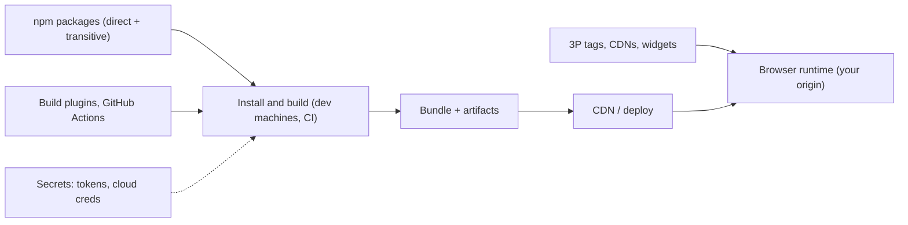
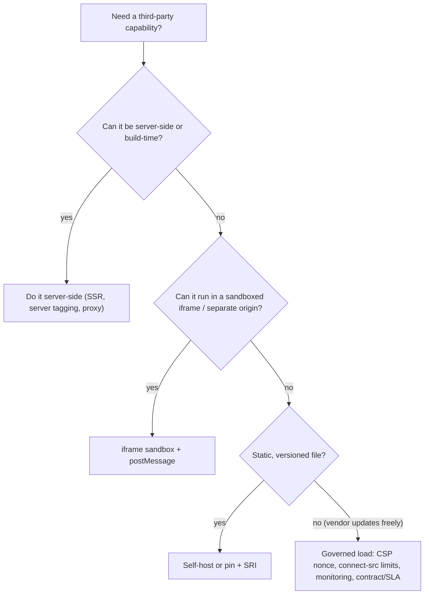
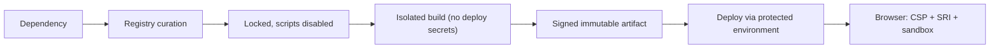

# Supply Chain and Third-Party Script Security

> Verification note: the OWASP Top 10:2025 category names **A03 Software Supply Chain Failures** and **A08 Software or Data Integrity Failures** were verified at top10.owasp.org/2025. CSP hash/nonce/`strict-dynamic`/SRI rules are from MDN (Mar 2026); RFC 10017 (Aug 2026) recommends limiting unchecked third-party resources, using SRI and nonce/hash CSP, and origin isolation. **Everything about npm/GitHub Actions/registry features (lifecycle scripts, provenance, cooldown settings, lockfile behaviour, `permissions:` defaults, action pinning) is general engineering knowledge not re-fetched in this session — marked *(hedged)* where specifics matter; verify against current npm/pnpm/GitHub docs.** Incident examples are described generically; check primary sources before quoting. Organisation defaults used in snippets: Artifactory npm virtual registry, `bby-ubuntu` runners, `bby-corp/tplat-gha-configure-github-credentials` for GIAM.

## Table of Contents

1. [Quick Summary (TL;DR)](#1-quick-summary-tldr)
2. [The Frontend Supply Chain Map](#2-the-frontend-supply-chain-map)
3. [Attack Patterns](#3-attack-patterns)
4. [Dependency Hygiene](#4-dependency-hygiene)
5. [Install-Time and Build-Time Risk](#5-install-time-and-build-time-risk)
6. [Registry and Artifactory Controls](#6-registry-and-artifactory-controls)
7. [CI/CD and GitHub Actions Hardening](#7-cicd-and-github-actions-hardening)
8. [Third-Party Scripts at Runtime](#8-third-party-scripts-at-runtime)
9. [Tag Managers, Analytics and Session Replay](#9-tag-managers-analytics-and-session-replay)
10. [Containing Third-Party Code](#10-containing-third-party-code)
11. [Provenance, SBOM and Integrity](#11-provenance-sbom-and-integrity)
12. [Detection and Incident Response](#12-detection-and-incident-response)
13. [Pitfalls](#13-pitfalls)
14. [Interview Questions — Fundamentals](#14-interview-questions--fundamentals)
15. [Interview Questions — Senior Scenarios](#15-interview-questions--senior-scenarios)
16. [Cheat Sheet](#16-cheat-sheet)
17. [Key Terms Glossary](#17-key-terms-glossary)
18. [Further Reading](#18-further-reading)

---

## 1. Quick Summary (TL;DR)

- **A frontend app is mostly other people's code:** hundreds or thousands of transitive npm packages, build plugins, CI actions, CDNs and marketing tags — each runs with **your privileges** (in the build) or **your origin's privileges** (in the browser). OWASP 2025 elevated this to **A03: Software Supply Chain Failures**.
- **Two arenas:**
  1. **Build/install-time:** malicious or compromised packages, install scripts, typosquats, dependency confusion, poisoned CI → steal secrets, backdoor bundles.
  2. **Runtime:** third-party `<script>` tags and CDNs → skimming, token theft, redirects.
- **Controls that matter most:** lockfiles + `npm ci`; pin/review upgrades with a **cooldown/age gate** *(hedged)*; private registry (Artifactory) with curation; minimal install-script execution; SCA alerts and rapid patching; **least-privilege CI tokens**, pinned actions, no untrusted input in shell; **SRI/self-hosting + strict CSP + origin isolation** for runtime scripts; provenance/SBOM; incident runbook.
- **Reduce the surface:** fewer dependencies, fewer third-party tags, prefer platform features, remove unused packages.
- **Assume compromise happens:** limit secrets available to installs/builds, separate build from publish/deploy credentials, and detect anomalous outbound requests.



---

## 2. The Frontend Supply Chain Map

| Layer | Examples | Trust issue |
|---|---|---|
| **Dependencies** | React, lodash, UI kits, transitive deps | Maintainer account takeover, malicious release, abandoned packages |
| **Install scripts** | `preinstall/install/postinstall` | Arbitrary code on dev/CI machines with network + env access |
| **Build tooling** | Webpack/Vite plugins, Babel/ESLint plugins, SWC/Turbopack binaries | Run with full filesystem and env access |
| **Package managers/registries** | npm, Artifactory, private scopes | Dependency confusion, mirrors, cache poisoning |
| **CI/CD** | GitHub Actions, reusable workflows, runners | Poisoned actions, leaked tokens, `pull_request_target` misuse |
| **Source control/dev** | Git hooks, IDE extensions, AI coding suggestions | Malicious extensions, hallucinated package names ("slopsquatting" *(hedged)*) |
| **Artifacts** | Docker images, build outputs | Tampering between build and deploy |
| **Runtime third parties** | Analytics, ads, A/B tools, chat, payment widgets, fonts, CDNs | Full DOM/cookie/storage access if same-origin scripts |
| **Content/config** | Remote config, feature flags, CMS-driven HTML | Injection via data channels |

---

## 3. Attack Patterns

| Pattern | How it works | Typical defence |
|---|---|---|
| **Typosquatting** | `reacct`, `lodash-utils` look-alike packages | Review new dependencies; allow-lists; scoped internal packages; tooling that flags look-alikes |
| **Dependency confusion** | Public package with the same name as an internal one wins resolution | Scope internal packages (`@org/*`), registry scoping, Artifactory virtual repos with explicit routing/priority rules |
| **Maintainer account takeover** | Phished/compromised publisher pushes a malicious version | 2FA/provenance on the publisher side; consumer-side **release cooldown**, lockfile review, SCA/malware feeds |
| **Malicious new maintainer / abandoned package transfer** | Trust inherited by a new owner | Monitor ownership/maintainer changes, prefer well-maintained deps |
| **Install-script malware** | Exfiltrates env vars, SSH keys, tokens on `npm install` | `--ignore-scripts` where feasible, allow-list scripts, isolated builders, no long-lived secrets in install steps |
| **Protestware / sabotage** | Maintainer intentionally breaks or alters behaviour | Pin, review diffs for critical deps, vendoring for key libs |
| **Compromised CDN/third-party script** | Host serves altered JS to all customers (a widely reported case involved a polyfill service domain changing hands and serving malicious code *(verify details)*) | Self-host/pin + SRI, CSP, avoid unneeded CDNs |
| **Magecart-style skimming** | Injected JS reads payment form fields | CSP `connect-src`/`form-action`, iframes for card fields (hosted fields), script change monitoring |
| **CI poisoning** | Malicious PR/workflow runs with secrets; mutable action tags replaced | Least-privilege `GITHUB_TOKEN`, pinned SHAs, no secrets for forks, careful `pull_request_target` |
| **Build artifact tampering** | Modify artifacts between build and deploy | Signed artifacts, immutable builds, provenance attestations |
| **Compromised dev tooling** | VS Code extensions, browser extensions on build machines | Extension allow-lists, managed devices |

---

## 4. Dependency Hygiene

1. **Commit lockfiles and install with `npm ci`** (or `pnpm install --frozen-lockfile`, `yarn install --immutable`) in CI so builds are reproducible and drift is visible *(hedged flags — verify per tool)*.
2. **Review dependency changes in PRs** — lockfile diffs, new transitive packages, install scripts, maintainer changes. Tools: `npm diff`, Socket/Snyk/Dependabot alerts *(hedged names)*.
3. **Automated update PRs** (Dependabot/Renovate) with **grouping** and **release-age gates** (e.g., "wait N days after publish" so malicious versions are typically caught before you adopt them) *(hedged: pnpm `minimumReleaseAge`, Renovate `minimumReleaseAge`, Dependabot cooldown — verify current option names)*.
4. **SCA** (`npm audit`, GitHub Dependabot alerts, OSV) with SLAs: critical in days, high in weeks; track **time-to-patch**; suppress with documented justification only.
5. **Pin exact versions for critical or build-time packages** where semver ranges would let unreviewed code in; understand that **lockfiles protect installs but not `npm install` without them**.
6. **Reduce dependencies:** audit with `depcheck`/bundle analysers; replace trivial packages (`is-odd`-style) with in-house code; prefer packages with active maintenance, multiple maintainers, provenance.
7. **Vendor or fork** truly critical, small libraries; mirror them in your registry.
8. **Don't `curl | bash`** installers or fetch scripts at build time without checksums.
9. **License compliance** is part of supply chain governance (SBOM tools).
10. **Review upgrades of build tooling** like production code: they run with secrets.

---

## 5. Install-Time and Build-Time Risk

- **Lifecycle scripts** (`preinstall`, `install`, `postinstall`, `prepare`) execute arbitrary code at install. Options *(hedged — verify behaviour per package manager version)*:
  - `npm ci --ignore-scripts` (then explicitly run required scripts, e.g., native module rebuilds), or per-package allow-lists (pnpm `onlyBuiltDependencies`, Yarn `enableScripts` settings).
  - Be aware that some packages legitimately need scripts (esbuild/sharp binaries) → allow-list them.
- **Least-privilege environment for install/build:** no deployment/cloud/registry-publish credentials in the same job as `npm ci` of untrusted code; separate **build** (read-only, no secrets) from **deploy** (secrets, protected environments).
- **Network egress controls** on CI runners (allow-list registries) limit exfiltration *(hedged; platform-dependent)*.
- **Reproducible builds:** pin Node version, lockfile, base images by digest; hash artifacts.
- **Dev machines:** use devcontainers/sandboxes for untrusted projects; keep `.npmrc` tokens scoped; avoid global installs of random CLIs.
- **Environment variables in builds:** `NEXT_PUBLIC_*`/`VITE_*` get inlined into client bundles — ensure only public values use those prefixes ([01 §7](01-frontend-threat-model-and-owasp-top-10.md#7-what-must-never-live-in-the-client)).

---

## 6. Registry and Artifactory Controls

Organisation guidance: use the **Artifactory npm virtual repository** as the single registry for npm/yarn/pnpm:
`https://artifactory.tools.bestbuy.com/artifactory/api/npm/npm-virtual`; container images from `https://containers.artifactory.tools.bestbuy.com`.

```ini
# .npmrc (project-level; never commit tokens)
registry=https://artifactory.tools.bestbuy.com/artifactory/api/npm/npm-virtual
@your-org:registry=https://artifactory.tools.bestbuy.com/artifactory/api/npm/npm-virtual
always-auth=true
```
Benefits and practices *(general; confirm available features with your Artifactory admins)*:
- **Single choke point** to block known-malicious packages, enforce curation/allow-lists, scan with Xray-style tools, cache upstream (resilience if npm is down/unpublished — also protects against left-pad-style removals).
- **Scoped internal packages** + routing rules to prevent **dependency confusion**.
- **Immutable releases** for internal packages; promote artifacts across repos (dev → staging → prod).
- **Retention and audit logs** for who downloaded what and when (useful in incident response).
- **Don't pull directly from the public registry** or random Git URLs in CI.
- Container supply chain: pin base images by **digest**, scan images, use minimal/distroless where appropriate.

---

## 7. CI/CD and GitHub Actions Hardening

*(General GitHub Actions guidance — hedged; verify against GitHub's security hardening docs.)*

```yaml
name: ci
on:
  pull_request:
  push:
    branches: [main]

permissions:
  contents: read            # default-deny; grant per job as needed

concurrency:
  group: ci-${{ github.ref }}
  cancel-in-progress: true

jobs:
  build:
    runs-on: bby-ubuntu
    steps:
      - uses: actions/checkout@<full-commit-sha>        # pin third-party actions by SHA, not mutable tags
        with:
          persist-credentials: false
      - uses: actions/setup-node@<full-commit-sha>
        with:
          node-version: 22
          cache: npm
          registry-url: https://artifactory.tools.bestbuy.com/artifactory/api/npm/npm-virtual
      - run: npm ci --ignore-scripts
      - run: npm rebuild esbuild                         # allow-list only needed native builds
      - run: npm audit --audit-level=high
      - run: npm test && npm run build

  deploy:
    needs: build
    if: github.ref == 'refs/heads/main'
    runs-on: bby-ubuntu
    environment: production                               # required reviewers / protected secrets
    permissions:
      contents: read
      id-token: write                                     # OIDC; no long-lived cloud keys
    steps:
      - uses: bby-corp/tplat-gha-configure-github-credentials@<full-commit-sha>   # GIAM credentials (org standard)
      # deploy steps here
```
Key practices:
1. **Least-privilege `permissions:`** at workflow and job level; default `GITHUB_TOKEN` to read-only.
2. **Pin actions to full commit SHAs** (tags/branches are mutable); review updates (Dependabot for Actions).
3. **Never interpolate untrusted input into `run:`** (PR titles, branch names, issue bodies, commit messages) — script injection; pass via `env:` and quote.
4. **`pull_request_target` and `workflow_run`** run with secrets/write tokens in the base context — **never check out and execute untrusted PR code** there.
5. **Separate build and deploy jobs**; protect production with **environments + required reviewers**; prefer **OIDC** short-lived credentials over stored cloud keys; use the org's GIAM action for credentials.
6. **Secrets scope:** repository/environment secrets only where needed; no secrets for forks; mask and rotate; secret scanning + push protection.
7. **Self-hosted/org runners:** ephemeral runners, network egress limits; `bby-*-xlarge` runners cost more — use only for memory-intensive jobs (organisation guidance), not for convenience.
8. **Branch protection:** required reviews, signed commits *(optional)*, status checks, CODEOWNERS on workflows (`.github/workflows/**`) and security-sensitive config.
9. **Cache poisoning:** treat caches as untrusted across trust boundaries (don't restore PR caches into release builds) *(hedged)*.
10. **Artifact integrity:** upload build artifacts once, deploy those exact artifacts (don't rebuild at deploy); record digests; generate **provenance attestations** ([§11](#11-provenance-sbom-and-integrity)).

---

## 8. Third-Party Scripts at Runtime

A third-party script included via `<script src>` is **first-party code from the browser's perspective**: it can read the DOM, cookies not marked HttpOnly, `localStorage`, intercept form input (keystrokes, card numbers), add listeners, make authenticated requests and load more scripts. RFC 10017 advises **limiting or avoiding unchecked third-party resources**, using **SRI**, nonce/hash CSP, and isolation.

### Decision framework


### Controls
| Control | Notes |
|---|---|
| **Inventory & ownership** | Every script has a business owner, purpose, data accessed, review date; remove stale tags |
| **Self-host/pin versions + SRI** | Prevents silent upstream changes; SRI needs `crossorigin`; doesn't work for self-updating snippets |
| **Strict CSP** | Nonce + `strict-dynamic` for loaders; narrow `connect-src`, `form-action`, `frame-src`, `img-src` to limit exfiltration ([03](03-content-security-policy-in-depth.md)) |
| **Load order/defer** | Load after critical paths; also a performance win ([web-performance/06](../web-performance/06-images-fonts-media-and-third-parties.md)) |
| **Permissions-Policy** | Deny camera/mic/geolocation etc. for third parties ([06](06-security-headers-cors-and-transport.md)) |
| **iframe `sandbox`** | `sandbox="allow-scripts"` (no `allow-same-origin`) gives an opaque origin; add `allow-forms`/`allow-popups` only as needed |
| **Hosted payment fields** | Use PSP-hosted iframes so card data never touches your DOM (reduces PCI scope; Magecart resistance) |
| **Change monitoring** | Detect changes to third-party script hashes/URLs (synthetic crawls, CSP reports, commercial monitors) |
| **Consent & privacy** | Don't load tracking before consent where required (GDPR/CCPA) |

---

## 9. Tag Managers, Analytics and Session Replay

- **Tag managers** let non-engineers deploy arbitrary JavaScript to production — **treat publish rights like production deploy rights**: SSO + MFA, approvals, audit logs, environments (staging/prod), allow-list of custom HTML tags, scheduled reviews, alerts on changes.
- **Server-side tagging** reduces client-side third-party code and exposure *(trade-offs: cost/complexity)*.
- **Session replay/analytics:** mask inputs by default (passwords, payment fields, PII), block sensitive pages, exclude `autocomplete` fields, review vendor data retention and regions; replay scripts can capture DOM content that includes secrets.
- **A/B testing/feature flag SDKs** that evaluate in the browser must not contain secrets or authorisation decisions ([01 §8](01-frontend-threat-model-and-owasp-top-10.md#8-client-side-validation-authorization-and-hidden-ui)).
- **Error reporting (Sentry etc.):** scrub PII/tokens from breadcrumbs, URLs and request bodies; restrict source map access.
- **Chat widgets/payments/maps** run in iframes or load scripts — apply the framework above.
- **Marketing pages vs app pages:** keep third-party-heavy marketing on a **different origin/subdomain with no session cookies**, and keep authenticated app pages nearly free of third-party code.

---

## 10. Containing Third-Party Code

| Technique | Strength | Cost |
|---|---|---|
| **Separate origin** for marketing/UGC (`www` vs `app`, different registrable domain or cookieless domain) | Strong (SOP) | Routing/SSO design; cookies must be host-only |
| **Sandboxed iframe** (opaque origin) | Strong for widgets | Layout/communication overhead |
| **Web Worker/Partytown-style offloading** *(hedged)* | Moves execution off main thread; **doesn't isolate** DOM access fully (proxying DOM) | Compatibility |
| **Realms/ShadowRealm, SES/Hardened JavaScript** *(hedged)* | Language-level isolation experiments | Maturity |
| **CSP restrictions** | Limits network/script loading | Doesn't stop DOM reads |
| **Monitoring/alerting** | Detects change | Reactive |

Principle (RFC 10017 §9.4): **one application per origin** so that browser isolation mechanisms (SOP, CORS, CSP) can be configured tightly.

---

## 11. Provenance, SBOM and Integrity

- **SBOM** (CycloneDX/SPDX *(hedged)*): machine-readable inventory of components, generated at build and stored with the artifact; enables fast "are we affected?" queries during incidents.
- **Provenance/attestations** *(hedged)*: package registries and CI can emit signed build provenance (e.g., npm provenance, GitHub artifact attestations, SLSA levels) proving which source/workflow produced an artifact; consumers can verify before deploying. Use for your own published packages and prefer dependencies that publish provenance.
- **Signing artifacts/containers** (Sigstore/cosign *(hedged)*) and verify at deploy.
- **Subresource Integrity (SRI)** for browser-loaded static third-party assets ([06 §11](06-security-headers-cors-and-transport.md#11-subresource-integrity-and-framing)).
- **Immutable infrastructure:** deploy by digest; prevent mutable tags in production manifests.
- **Frameworks like SLSA** provide maturity levels for build integrity *(hedged)*.

---

## 12. Detection and Incident Response

### Detection signals
- SCA/malware alerts, registry advisories, unexpected new transitive dependencies or install scripts in lockfile diffs.
- CI anomalies: unusual outbound connections, new secrets usage, workflow changes by unexpected authors.
- Browser: CSP violations for unknown hosts, changes in third-party script hashes, unexpected `connect-src` blocked requests (exfil attempts), RUM anomalies (new network calls).
- Customer reports of phishing overlays/redirects.

### Runbook: "A dependency we use was compromised"
1. **Confirm exposure:** search lockfiles/SBOMs across repos for the affected versions (`npm ls`, registry logs, Artifactory download logs).
2. **Contain:** block the version in the registry, pin/revert to a known-good version, stop deployments of affected builds, disable affected CI jobs.
3. **Assess impact:** did install scripts run in CI/dev machines (which secrets/tokens were in env)? Did the malicious code ship in client bundles (what data could it access)?
4. **Rotate credentials:** CI tokens, npm tokens, cloud keys, API secrets exposed to affected jobs; invalidate user sessions if browser-side code may have exfiltrated tokens.
5. **Eradicate & rebuild:** clean caches, rebuild from verified sources, redeploy; verify artifact hashes.
6. **Communicate:** internal incident channel, security team, customers/regulators if required.
7. **Learn:** add controls (cooldowns, script restrictions, provenance), update inventories, run a post-mortem.

### Runbook: "A third-party script was compromised"
Remove/disable the tag (tag manager kill switch), serve a CSP that blocks the host, review logs/CSP reports for exfil destinations, assess data exposed (forms/pages where script loaded), rotate affected secrets/sessions, notify per policy, add SRI/self-hosting/sandboxing, update vendor risk register.

---

## 13. Pitfalls

1. **`npm install` instead of `npm ci`** in CI (lockfile drift, unreviewed upgrades).
2. **Auto-merging dependency updates** without age gates/review for build-time packages.
3. **Install scripts running with production secrets** in the environment.
4. **Mutable action tags** (`@v4`, `@main`) for sensitive jobs; unpinned third-party actions.
5. **Overbroad `GITHUB_TOKEN` permissions** and long-lived cloud keys in secrets.
6. **`pull_request_target` executing PR code.**
7. **Untrusted input in shell** (`run: echo ${{ github.event.pull_request.title }}`).
8. **Loading analytics/ads on authenticated app pages.**
9. **SRI on dynamic third-party scripts** (breaks on legitimate updates, leading teams to disable it).
10. **Tag manager admin access for many users with no audit.**
11. **Ignoring transitive dependencies** and abandoned packages.
12. **Directly pulling from public registries/Git URLs** bypassing Artifactory curation.
13. **No SBOM/inventory** → can't answer "are we affected?" quickly.
14. **Source maps and CI logs exposing secrets or internal details.**

---

## 14. Interview Questions — Fundamentals

### Q1. What is a software supply chain attack?
Compromising something you depend on (a package, build tool, CI action, CDN script) so malicious code runs in your build or in your users' browsers.

### Q2. What is dependency confusion and how do you prevent it?
Public registries resolve a package name that you meant to be internal; prevent via scoped names, registry routing rules (private repo takes precedence for your scope), and virtual repository configuration.

### Q3. Why use `npm ci` in CI?
It installs exactly from the lockfile, fails on mismatches, and is deterministic, preventing unreviewed version drift.

### Q4. What does SRI do and when can't you use it?
It verifies a fetched resource's hash; it can't be used for resources that legitimately change (self-updating vendor snippets) and requires CORS for cross-origin assets.

### Q5. Why are install scripts risky?
They execute arbitrary code during install with the user's/CI's environment, enabling credential theft.

### Q6. How can a third-party script steal data on your page?
It runs in your origin: reads the DOM and non-HttpOnly cookies/storage, intercepts form fields, and sends data to any allowed endpoint (limited by CSP `connect-src`).

### Q7. What is least privilege for GitHub Actions?
Set `permissions:` to the minimum (usually `contents: read`), pin actions by SHA, scope secrets to environments, use OIDC rather than long-lived keys.

### Q8. What is an SBOM?
A Software Bill of Materials listing the components in an artifact, enabling rapid impact analysis when a vulnerability is announced.

---

## 15. Interview Questions — Senior Scenarios

### S1. "A popular npm package we use released a version that exfiltrates env vars in a postinstall script. How do you respond?"
Follow the runbook: identify affected repos/builds (lockfiles/SBOM/registry logs), block the version in Artifactory, revert/pin, determine which CI jobs/dev machines installed it and which secrets were present, rotate those credentials, rebuild and redeploy clean artifacts, and add controls (ignore-scripts, release-age gate, secrets isolated from install steps, egress restrictions).

### S2. "Marketing wants to add a new personalisation script to the checkout page."
Challenge the need: avoid third-party scripts on payment/authenticated pages; if unavoidable, run it in a sandboxed iframe/server-side, enforce CSP with narrow `connect-src`, hosted payment fields, no access to card inputs, vendor security review, feature flag/kill switch, monitoring and audit trail; consider a different page or server-side integration.

### S3. "How would you secure a GitHub Actions pipeline that builds and deploys a Next.js app?"
Least-privilege `permissions`, pinned SHAs, separate build/deploy jobs with protected environments, OIDC/GIAM short-lived credentials, `npm ci --ignore-scripts` plus explicit rebuilds, Artifactory registry, secret scanning, no untrusted input in `run`, CODEOWNERS on workflows, immutable artifacts with attestations, and alerts on workflow changes.

### S4. "We allow-listed `cdn.vendor.com` in CSP; the vendor was breached. What happened and how do you prevent recurrence?"
Allow-listing a host trusts everything it serves; the attacker's code passed CSP. Move to nonce/hash + `strict-dynamic` with self-hosted or SRI-pinned versions, restrict `connect-src`, sandbox/isolate, monitor vendor changes, and keep a kill switch.

### S5. "Propose a dependency policy for a 50-engineer frontend org."
Central registry (Artifactory) with curation; lockfiles and `npm ci`; Dependabot/Renovate with grouped updates + age gate; SCA with SLAs; allow-list for install scripts; new dependency review checklist (maintenance, size, license, scripts); quarterly dependency pruning; SBOM generation; incident runbook; security champions; measure vulnerable dependency age and time-to-patch.

---

## 16. Cheat Sheet

| Risk | Control |
|---|---|
| Malicious version | Lockfile, `npm ci`, age gate, review, SCA |
| Install script malware | `--ignore-scripts`, allow-list, no secrets in install |
| Dependency confusion | Scoped packages, Artifactory routing |
| CI compromise | Least privilege, pinned SHAs, protected environments, OIDC/GIAM |
| Runtime script risk | Self-host/SRI, strict CSP, iframe sandbox, separate origin |
| Tag manager abuse | SSO/MFA, approvals, audit, kill switch |
| Unknown exposure | SBOM + registry logs |



---

## 17. Key Terms Glossary

| Term | Definition |
|---|---|
| **SCA** | Software composition analysis (dependency vulnerability scanning) |
| **Typosquatting** | Look-alike package names |
| **Dependency confusion** | Public package overriding an internal name |
| **SRI** | Subresource Integrity hash check |
| **SBOM** | Software bill of materials |
| **Provenance** | Verifiable record of how an artifact was built |
| **SLSA** | Supply-chain Levels for Software Artifacts *(hedged)* |
| **Magecart** | Skimming attacks via injected JavaScript |
| **OIDC (CI)** | Short-lived workload identity tokens for pipelines |

---

## 18. Further Reading

- [OWASP Top 10:2025 — A03 Software Supply Chain Failures](https://top10.owasp.org/2025/A03_2025-Software_Supply_Chain_Failures/) · [A08 Software or Data Integrity Failures](https://top10.owasp.org/2025/A08_2025-Software_or_Data_Integrity_Failures/)
- [GitHub Docs — Security hardening for GitHub Actions](https://docs.github.com/en/actions/security-for-github-actions) · [npm Docs — Securing your dependencies](https://docs.npmjs.com/) · [SLSA](https://slsa.dev/) · [OWASP NPM Security Cheat Sheet](https://cheatsheetseries.owasp.org/cheatsheets/NPM_Security_Cheat_Sheet.html)
- This repo: [03 CSP in depth](03-content-security-policy-in-depth.md) · [06 Headers, CORS and transport](06-security-headers-cors-and-transport.md) · [web-performance/06 Third-party scripts](../web-performance/06-images-fonts-media-and-third-parties.md)
