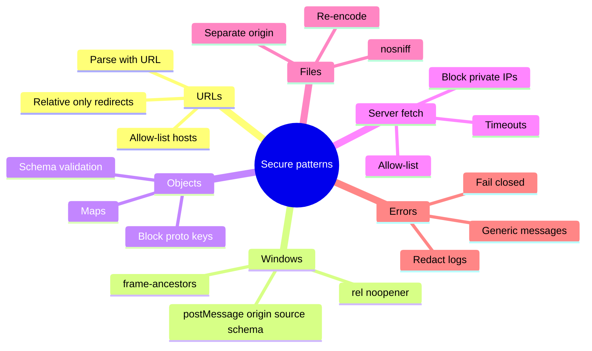

# Secure Frontend Patterns and Vulnerability Catalogue

> Verification note: this file consolidates vulnerability classes that earlier files reference. Facts verified in this folder's sources: same-origin/`postMessage` model and cookie scoping (MDN SOP Sep 2026, Cookies Sep 2026), CSP directives (`frame-ancestors`, `form-action` usage), RFC 10017 (postMessage origin verification on both sides, BFF outbound allow-listing, prototype poisoning risk), OWASP Top 10:2025 category names (A04 Cryptographic Failures, A06 Insecure Design, A09 Logging and Alerting Failures, A10 Mishandling of Exceptional Conditions). Attack-class descriptions, payload patterns, library/CVE-adjacent details, `rel` defaults, upload-handling specifics and logging guidance are standards/industry knowledge and marked *(hedged)* where details vary by browser or version. Companion files: [02 XSS](02-xss-trusted-types-and-sanitization.md), [04 CSRF](04-cookies-sessions-and-csrf.md), [05 Auth](05-authentication-and-authorization-in-the-frontend.md), [06 Headers](06-security-headers-cors-and-transport.md).

## Table of Contents

1. [Quick Summary (TL;DR)](#1-quick-summary-tldr)
2. [Open Redirects and URL Handling](#2-open-redirects-and-url-handling)
3. [Clickjacking and UI Redressing](#3-clickjacking-and-ui-redressing)
4. [`window.opener`, Tabnabbing and Popups](#4-windowopener-tabnabbing-and-popups)
5. [`postMessage` Security](#5-postmessage-security)
6. [Prototype Pollution](#6-prototype-pollution)
7. [DOM Clobbering](#7-dom-clobbering)
8. [SSRF and Open Proxies (BFF, Route Handlers, Image Optimizers)](#8-ssrf-and-open-proxies-bff-route-handlers-image-optimizers)
9. [File Upload and Download Security](#9-file-upload-and-download-security)
10. [Injection Beyond XSS: JSON, GraphQL, Templates, Regex](#10-injection-beyond-xss-json-graphql-templates-regex)
11. [Secrets, Source Maps and Sensitive Data Exposure](#11-secrets-source-maps-and-sensitive-data-exposure)
12. [Logging, Errors and Failing Safely](#12-logging-errors-and-failing-safely)
13. [WebSockets, SSE and Real-Time Channels](#13-websockets-sse-and-real-time-channels)
14. [Business Logic, Abuse and Privacy](#14-business-logic-abuse-and-privacy)
15. [Vulnerability Catalogue (Defence Matrix)](#15-vulnerability-catalogue-defence-matrix)
16. [Secure Code Review Checklist](#16-secure-code-review-checklist)
17. [Pitfalls](#17-pitfalls)
18. [Interview Questions — Fundamentals](#18-interview-questions--fundamentals)
19. [Interview Questions — Senior Scenarios](#19-interview-questions--senior-scenarios)
20. [Cheat Sheet](#20-cheat-sheet)
21. [Key Terms Glossary](#21-key-terms-glossary)
22. [Further Reading](#22-further-reading)

---

## 1. Quick Summary (TL;DR)

- Beyond XSS/CSRF/auth, frontend engineers meet a recurring set of bugs: **open redirects**, **clickjacking**, **tabnabbing**, **unsafe `postMessage`**, **prototype pollution**, **DOM clobbering**, **SSRF through BFF/proxy/image-fetch features**, **unsafe uploads**, **secrets and PII leakage**, and **fail-open error handling**.
- **Common root causes:** trusting data from URLs/messages/APIs, building URLs or paths by string concatenation, over-permissive allow-lists, missing origin checks, and assuming the client environment is benign.
- **Reusable defences:** a single **URL validator/allow-list**, a vetted **`postMessage` wrapper** (origin + schema checks), **safe object merging** (no `__proto__`/`constructor`), **header-based framing protection**, **separate origins for untrusted content**, **allow-listed server-side fetching**, **log redaction**, **fail-closed defaults**, and tests/lint to keep them in place.
- Interview style: name the **source → sink**, the **impact**, a **minimal PoC idea**, and **two layers of mitigation**.

---

## 2. Open Redirects and URL Handling

**Vulnerability:** a page redirects to a user-controlled destination (`/login?next=https://evil.com`), enabling phishing, OAuth code/token theft (redirect URI abuse), and bypass of allow-list-based defences (CSP/SSRF/CORS allow-lists that trust your domain).

```ts
// Vulnerable
router.push(new URLSearchParams(location.search).get('next') ?? '/');
window.location.href = params.get('returnTo')!;
```

**Mitigations**
1. Prefer **relative paths only**: accept `returnTo` values that start with `/` but not `//` or `/\`, and normalise with `new URL(value, origin)` then verify `url.origin === location.origin`.
2. **Allow-list** known destinations/paths for cross-domain redirects; or use opaque IDs (`?next=dashboard`) mapped server-side.
3. **Block dangerous schemes** (`javascript:`, `data:`, `vbscript:`) — parse first, then check the protocol ([02 §9](02-xss-trusted-types-and-sanitization.md#9-urls-attributes-and-css-injection)).
4. Beware parser differentials: backslashes, whitespace/control characters, `@` userinfo (`https://example.com@evil.com`), unicode/IDN homographs, encoded slashes *(hedged — normalise via the platform URL parser, not regexes)*.
5. **OAuth:** register **exact redirect URIs** only (RFC 10017/9700) — wildcard patterns create open-redirect token leaks.
6. For server redirects, validate on the server too (client checks are bypassable).

```ts
export function safeRedirectPath(raw: string | null, fallback = '/'): string {
  if (!raw) return fallback;
  try {
    const u = new URL(raw, window.location.origin);
    if (u.origin !== window.location.origin) return fallback;
    if (raw.startsWith('//') || raw.startsWith('/\\')) return fallback;
    return u.pathname + u.search + u.hash;
  } catch { return fallback; }
}
```

---

## 3. Clickjacking and UI Redressing

**Attack:** the attacker frames your page in a transparent iframe over a decoy UI so users click your buttons unknowingly (change settings, approve payments, grant permissions).

**Defences**
| Layer | Control |
|---|---|
| **Headers (primary)** | `Content-Security-Policy: frame-ancestors 'none'` (or specific origins); legacy `X-Frame-Options: DENY/SAMEORIGIN` — MDN: `frame-ancestors` is the more flexible replacement |
| **Cookies** | `SameSite=Lax/Strict` stops authenticated framing in many cases (the framed page loads logged-out) *(hedged: defence in depth only)* |
| **UX friction** | Re-authentication/confirmation for sensitive actions, not just a click |
| **JS frame-busting** | Unreliable (sandboxed iframes can disable scripts) — don't depend on it |
| **Embeddable widgets you provide** | `frame-ancestors` allow-list per customer, `postMessage` origin checks, `Permissions-Policy` |

Related: **drag-and-drop/UI redress**, **cursorjacking**, **fake overlays from XSS** (CSP/XSS prevention), **tapjacking** on mobile *(hedged)*.

---

## 4. `window.opener`, Tabnabbing and Popups

- **Reverse tabnabbing:** a page opened via `target="_blank"` can access `window.opener` (cross-origin limited to `opener.location` assignment — MDN SOP lists `location` as writable) and redirect your original tab to a phishing page.
- **Mitigation:** add `rel="noopener noreferrer"` to external `target="_blank"` links; modern browsers treat `target=_blank` as `noopener` by default *(hedged — still add `rel` for clarity/older engines)*; use `window.open(url, '_blank', 'noopener,noreferrer')`.
- **COOP** (`same-origin`) isolates your window from cross-origin popups/openers ([06 §8](06-security-headers-cors-and-transport.md#8-isolation-headers-coop-coep-corp)); beware it breaks `window.opener`-based OAuth popup flows.
- **User-generated links:** force `rel="noopener noreferrer nofollow ugc"` *(SEO/spam: `ugc`/`nofollow`)* and show the destination for external links in sensitive contexts.

```tsx
export function ExternalLink({ href, children }: { href: string; children: React.ReactNode }) {
  const safe = safeUrl(href, ['https:', 'http:', 'mailto:']);        // see 02 §9
  if (!safe) return <span>{children}</span>;
  return <a href={safe} target="_blank" rel="noopener noreferrer">{children}</a>;
}
```

---

## 5. `postMessage` Security

**Risks:** (1) **sending** sensitive data to the wrong origin (`targetOrigin: '*'`), (2) **receiving** messages from any origin and acting on them (XSS/DOM injection, state tampering, privilege actions).

```ts
// Sender: always pin the target origin (never '*', never for secrets)
iframe.contentWindow!.postMessage({ type: 'init', payload }, 'https://widget.example.com');

// Receiver: verify origin AND source AND schema
const ALLOWED_ORIGIN = 'https://widget.example.com';
window.addEventListener('message', (e: MessageEvent) => {
  if (e.origin !== ALLOWED_ORIGIN) return;                    // exact string comparison, not includes/endsWith
  if (e.source !== iframe.contentWindow) return;              // expected window
  const msg = parseMessage(e.data);                           // validate schema (Zod/Valibot); ignore unknown types
  if (!msg) return;
  handle(msg);
});
```
Rules:
- RFC 10017 §6.3.3.3: for in-browser communication flows (popups/iframes), **both the initiator origin and receiver origin MUST be verified** using the mechanisms in `postMessage` itself.
- **Never use `innerHTML`/`eval` with message data**; treat as untrusted input.
- Use **`MessageChannel`** ports for private channels after an initial handshake; **structured clone** carries data, not code.
- **Sandboxed iframes** have an opaque origin (`'null'` string) — don't allow-list `"null"`.
- Avoid broadcasting state via `window.name`/`location.hash`.
- **Micro-frontends/embeds:** version messages, namespace them, and authenticate the parent/child relationship.

---

## 6. Prototype Pollution

**Vulnerability:** attacker-controlled keys (`__proto__`, `constructor.prototype`) in a merge/set operation modify `Object.prototype`, affecting every object in the realm (gadgets: `isAdmin`, `innerHTML`/`src` options, template configs). Client-side prototype pollution can escalate to **XSS** (polluted properties read by libraries), and RFC 10017 notes attackers can substitute built-ins (prototype poisoning) to leak data from closures.

```ts
// Vulnerable deep merge
function merge(target: any, source: any) {
  for (const key in source) {
    if (typeof source[key] === 'object') merge(target[key] ??= {}, source[key]);
    else target[key] = source[key];
  }
}
merge({}, JSON.parse('{"__proto__":{"isAdmin":true}}'));   // ({}).isAdmin === true
```
**Mitigations**
- Block `__proto__`, `constructor`, `prototype` keys; use `Object.create(null)` or `Map` for dictionaries; `Object.hasOwn(obj, key)`.
- Prefer **well-maintained merge utilities with fixes** and keep them updated (lodash, minimist, qs, etc. historically had such issues *(hedged)*).
- Validate input with **schemas** before merging; use `structuredClone`/spread for shallow copies.
- Freeze prototypes in hardened contexts: `Object.freeze(Object.prototype)` *(hedged: can break libraries)*, or Node `--disable-proto=delete` *(server)*.
- Don't parse query strings into nested objects blindly (`?__proto__[x]=1`); configure parsers to disable prototype keys.
- **CSP + Trusted Types** limit gadget exploitation.

---

## 7. DOM Clobbering

**Vulnerability:** elements with `id`/`name` attributes become properties on `window`/`document`, so injected HTML (even when scripts are blocked) can overwrite globals used by code (`window.config`, `document.cookie`-like lookups, `if (!window.TRUSTED_URL)`).

```html
<!-- attacker-injected, allowed by a sanitizer that keeps id/name -->
<a id="config"><a id="config" name="apiBase" href="https://evil.example/">
```
```js
const base = window.config?.apiBase ?? '/api';   // now attacker-controlled string via HTMLCollection quirks
```
**Mitigations**
- Don't rely on implicit globals; use modules/consts; check types (`instanceof`, `typeof`) before use.
- **Sanitise `id`/`name`** attributes in user HTML (or namespace them) — default sanitiser configs may drop or allow them *(hedged: check DOMPurify `SANITIZE_DOM`/`SANITIZE_NAMED_PROPS` options)*.
- Render user content inside Shadow DOM or a sandboxed iframe for isolation ([browser-internals/07](../browser-internals/07-events-dom-apis-and-web-components.md)).
- CSP blocks script, but clobbering abuses existing scripts, so code hygiene matters.

---

## 8. SSRF and Open Proxies (BFF, Route Handlers, Image Optimizers)

Frontend teams increasingly own **server-side code** (Next.js route handlers, Server Actions, BFFs, image optimisation, link previews, webhooks, PDF/screenshot services). Any feature that **fetches a user-supplied URL** is an **SSRF** risk: attackers reach internal services, cloud metadata endpoints, localhost admin panels.

**Mitigations**
1. **Allow-list** hosts/paths/methods; map route → fixed upstream (RFC 10017 §6.1.3.6 requires BFFs to maintain an explicit allow-list so the user's access token can't be sent to attacker servers).
2. For unavoidable user-supplied URLs (link previews): resolve DNS server-side, **block private/loopback/link-local ranges and metadata IPs**, re-validate after redirects (or disable redirects), enforce **timeouts and size limits**, restrict protocols to `http/https`, and run in an **isolated network segment** with no credentials.
3. **Next.js images:** use strict `remotePatterns` (not broad wildcards); `images.domains` is deprecated; Next 16 blocks local IPs by default (`dangerouslyAllowLocalIP`) and limits redirects (from Next docs researched earlier).
4. **Never forward cookies/Authorization** to user-chosen hosts; strip hop-by-hop and sensitive headers.
5. **Path traversal in proxies:** normalise and reject `..`, encoded variants, and double-encoding before concatenating paths.
6. **Webhook/URL import features:** same controls plus per-tenant allow-lists.

```ts
// Safer proxy target construction
const BASES: Record<string, string> = { orders: 'https://orders.internal.example.com', profile: 'https://profile.internal.example.com' };
function upstream(service: string, path: string): URL {
  const base = BASES[service];
  if (!base) throw new Error('unknown service');
  const u = new URL(path.replace(/^\/+/, ''), base + '/');
  if (u.origin !== new URL(base).origin) throw new Error('origin mismatch');   // blocks absolute URLs/@ tricks
  return u;
}
```

---

## 9. File Upload and Download Security

| Risk | Mitigation |
|---|---|
| **Malicious file types** (HTML/SVG/PDF with script, polyglots) | Server-side validation by content (magic bytes), allow-list of extensions/MIME, **re-encode images** (strip metadata, neutralise payloads), scan with AV where needed |
| **Stored XSS via uploads served from app origin** | Serve from a **separate cookieless origin** with `X-Content-Type-Options: nosniff`, `Content-Disposition: attachment` for non-image types, CSP `sandbox` |
| **Large files/zip bombs/DoS** | Size limits at edge/server, streaming limits, decompression limits, rate limits |
| **Path traversal in filenames** | Generate server-side random names; never trust client file names; sanitise for display |
| **Direct-to-storage (presigned URLs)** | Short-lived, **scoped to key, method, content-type and max size**; validate after upload (webhook) before making public; prevent overwrites |
| **IDOR on downloads** | Authorisation check on every download; unguessable keys are not authorisation |
| **Client-side checks only** | Extension/MIME checks in the browser are UX only |
| **Image/EXIF privacy** | Strip GPS and metadata when appropriate |
| **CSV/Excel formula injection** | Prefix cells starting with `= + - @` when exporting user data *(hedged)* |
| **Content sniffing** | Always set `Content-Type` and `nosniff` |

---

## 10. Injection Beyond XSS: JSON, GraphQL, Templates, Regex

- **JSON injection in SSR scripts:** see [02 §10](02-xss-trusted-types-and-sanitization.md#10-serializing-data-into-html-ssr-state-injection).
- **SQL/NoSQL/command injection** originate server-side but arrive via frontend inputs: use parameterised queries/ORMs, schema validation (Zod), allow-listed sort/filter fields (`?sort=name` mapped, not concatenated). NoSQL operator injection (`{"$ne": null}`) arises when JSON bodies are passed directly to queries *(hedged)*.
- **GraphQL:** enforce **authorisation per resolver/field**, limit **query depth/complexity/aliases/batching** (DoS and brute-force amplification), disable or protect introspection/GraphiQL in production where appropriate, use persisted queries *(hedged)*.
- **Template/expression injection** (server templating, MDX, Markdown plugins, Handlebars) — never compile user-supplied templates/MDX on the server without sandboxing; MDX execution = code execution.
- **Header/CRLF injection:** don't place user input into response headers/redirect URLs without validation.
- **Regular-expression DoS (ReDoS):** avoid catastrophic patterns (nested quantifiers) on user input in client and server; use linear-time engines/limits, input length caps, and tested patterns.
- **Mass assignment:** don't spread entire request bodies into DB updates (`{...req.body}`); pick allowed fields (property-level authz).
- **Open CORS/CSP allow-list gadgets:** see [03](03-content-security-policy-in-depth.md) and [06](06-security-headers-cors-and-transport.md).

---

## 11. Secrets, Source Maps and Sensitive Data Exposure

OWASP 2025 **A04 Cryptographic Failures** includes sensitive data exposure and weak/absent protection of secrets in transit and at rest.

- **Secrets in bundles:** `NEXT_PUBLIC_*`, `VITE_*`, `REACT_APP_*` and similar prefixes inline values at build time; **API keys that grant privileges must stay server-side**. "Public" keys (Maps, Stripe publishable) should be **restricted** (HTTP referrer, bundle ID, scopes, quotas).
- **Git hygiene:** secret scanning + push protection, `.env` ignored, rotate any leaked secret (assume compromised once committed/pushed).
- **Source maps:** shipping public source maps makes reverse-engineering easier (not a vulnerability by itself); prefer uploading to error trackers and serving maps privately/authenticated; never include secrets in comments/config.
- **Client-side "encryption":** encrypting data with a key shipped in the bundle is obfuscation, not protection. Use TLS in transit, server-side encryption at rest, and **WebCrypto only for appropriate client-held keys** (e.g., end-to-end encryption designs with proper key management — [system-design/04](../system-design/04-chat-and-real-time-messaging.md)).
- **Sensitive data in storage:** avoid `localStorage`/IndexedDB for secrets/PII; if offline data is required, minimise, encrypt at rest *(hedged: non-extractable key ≠ guarantee)*, expire, and clear on logout ([browser-internals/05](../browser-internals/05-browser-storage-and-caching-apis.md)).
- **URLs/analytics:** keep PII and tokens out of URLs, titles, analytics events and error reports.
- **Autofill/credentials:** correct `autocomplete` attributes; `type="password"`; disable caching for sensitive forms where needed; mask sensitive values in screenshots/session replay.
- **Clipboard/OS-level leaks:** avoid putting secrets on the clipboard *(hedged)*; use secure input patterns for OTPs.

---

## 12. Logging, Errors and Failing Safely

- **OWASP 2025 A09 Security Logging and Alerting Failures:** log security-relevant events server-side (auth success/failure, permission denials, input validation failures, admin actions) with **actor, action, target, time, request ID**; protect and monitor logs; alert on anomalies. Frontend contributes **CSP/Trusted Types/Reporting API** reports and client error telemetry (carefully scrubbed).
- **Redact:** passwords, tokens, session IDs, full card numbers, national IDs, auth headers, URLs with secrets; avoid logging request/response bodies by default; apply scrubbing rules in Sentry/Datadog RUM.
- **A10 Mishandling of Exceptional Conditions:** errors must not bypass controls or leak internals.
  - **Fail closed:** if permission/feature/entitlement fetch fails, hide/deny — don't default to "allowed".
  - **No stack traces/internal IDs** in user-facing errors; map to generic messages with correlation IDs.
  - **Handle promise rejections and error boundaries** so partially rendered privileged UI doesn't show.
  - **Consistent error responses** to avoid oracle behaviours (e.g., enumeration, padding oracles).
  - **Timeouts/retries/backoff** with caps; idempotency keys for mutations; no infinite retry loops that DoS your own API.
  - **Graceful degradation** shouldn't expose stale privileged data after logout.
- **Release safety:** feature flags/kill switches, canary deployments, rollback plans.

```tsx
// Fail-closed capability check
function useCan(permission: string) {
  const { data, error } = useCapabilities();           // fetched from server
  if (error || !data) return false;                    // default deny on failure/loading
  return data.permissions.includes(permission);
}
```

---

## 13. WebSockets, SSE and Real-Time Channels

- **WebSocket handshake carries cookies** and is not governed by SOP/CORS → **Cross-Site WebSocket Hijacking (CSWSH)**: verify the **`Origin`** header server-side on upgrade; use tokens in the first message or short-lived ticket in the URL query (single-use, short TTL, not logged).
- **Authorise every message/subscription/channel join** server-side (IDOR in `room_id`); don't trust client-provided user IDs.
- **Validate message schemas and sizes**; rate-limit per connection; protect against fan-out DoS.
- **Transport:** `wss://` only; heartbeat/idle timeouts; reconnect with backoff and re-auth.
- **SSE (`EventSource`)** uses cookies by default (`withCredentials` for cross-origin) — apply CSRF/CORS thinking; sanitise rendered content ([system-design/04](../system-design/04-chat-and-real-time-messaging.md)).
- **Output encoding** still applies: chat messages are a classic stored XSS surface.

---

## 14. Business Logic, Abuse and Privacy

- **Insecure Design (A06)** — flaws in workflows rather than code bugs: price/discount tampering, coupon replay, race conditions (double spend), skipping steps in multi-step flows, trusting hidden form fields. Fixes: server-side calculation, state machines enforced server-side, idempotency, locking/transactions, rate limits, abuse-case reviews ([§4 of file 01](01-frontend-threat-model-and-owasp-top-10.md#4-threat-modelling-a-frontend-feature)).
- **Bot/abuse controls:** rate limits, CAPTCHAs/challenges, behavioural signals, device attestation *(hedged)*, server-side quotas.
- **Race conditions in the UI** (double submit) — disable buttons for UX, **idempotency keys** for correctness.
- **Privacy & compliance** *(general)*: consent management for cookies/trackers (GDPR/ePrivacy/CCPA per MDN's cookie regulations note), data minimisation, retention, right-to-delete flows, regional data handling, child-safety requirements; avoid collecting more data in the client than needed.
- **Accessibility vs security:** don't disable paste/autofill for passwords; provide accessible MFA alternatives.
- **Content integrity:** protect against phishing overlays and fake UI (CSP, trusted UI patterns, consistent security indicators).

---

## 15. Vulnerability Catalogue (Defence Matrix)

| Vulnerability | Source → Sink | Impact | Primary mitigation | Secondary |
|---|---|---|---|---|
| **Reflected/stored/DOM XSS** | Input → HTML/JS sink | Account takeover | Encode, sanitise, safe APIs | CSP, Trusted Types, HttpOnly/BFF |
| **CSRF** | Cross-site request + cookies | Unwanted actions | SameSite + token/custom header | Origin/Fetch Metadata |
| **Open redirect** | `next` param → navigation | Phishing, token leakage | Relative-only/allow-list | Exact OAuth redirect URIs |
| **Clickjacking** | Framed page | Unintended actions | `frame-ancestors` | Re-auth, SameSite |
| **Tabnabbing** | `target=_blank` + opener | Phishing | `rel=noopener` | COOP |
| **Unsafe `postMessage`** | Message → handler | Data leak, XSS | Origin + source + schema checks | Pin `targetOrigin` |
| **Prototype pollution** | Key path → object | Logic bypass, XSS | Block proto keys, schemas | Maps, updated libs |
| **DOM clobbering** | id/name → globals | Logic bypass | No implicit globals, sanitise id/name | Shadow DOM |
| **SSRF/open proxy** | URL param → server fetch | Internal access, token leak | Allow-lists, network isolation | Timeouts, no creds |
| **Insecure upload** | File → served content | Stored XSS, RCE, DoS | Separate origin, re-encode, limits | AV, presigned constraints |
| **IDOR/BOLA** | ID → object | Data exposure | Object-level authz | Unguessable IDs, logging |
| **Token theft** | XSS → storage | Account takeover | BFF/HttpOnly | Short TTL, DPoP, CSP |
| **Supply-chain** | Package/script → code exec | Full compromise | Lockfile, curation, SRI, CSP | Provenance, monitoring |
| **CORS misconfig** | Reflected Origin + credentials | Data theft | Exact allow-list | `Vary`, CSRF tokens |
| **Secrets in bundle** | Env → client | API abuse | Server-side secrets | Rotation, scanning |
| **Fail-open errors** | Exception → allow | Authz bypass | Default deny | Tests, alerts |
| **CSWSH** | Cookie + WS upgrade | Hijacked real-time actions | Origin check, tokens | Per-message authz |
| **ReDoS / DoS** | Input → regex/parse | Outage | Limits, safe patterns | Rate limits |

---

## 16. Secure Code Review Checklist

**Inputs & rendering**
- [ ] Any `dangerouslySetInnerHTML`, `innerHTML`, `eval`, `v-html`, `bypassSecurityTrust*`? Sanitiser + tests?
- [ ] URLs from users validated (scheme/host) before `href`, `src`, `window.open`, redirects?
- [ ] State serialised into HTML escaped properly?
- [ ] Prototype-unsafe merges, dynamic property writes with user keys?

**Auth & access**
- [ ] Server-side authn/authz on every route, Server Action and route handler?
- [ ] Object-level checks and tenant scoping?
- [ ] Tokens kept out of `localStorage`; cookies `Secure/HttpOnly/SameSite/__Host-`?
- [ ] CSRF defence for cookie-authenticated mutations?

**Cross-origin & headers**
- [ ] CORS exact allow-list; credentials handled correctly; `Vary: Origin`?
- [ ] `postMessage` origin/source/schema checks?
- [ ] CSP/`frame-ancestors`/`nosniff`/`Referrer-Policy` intact?

**Data & secrets**
- [ ] No secrets in client env/bundles; PII not in URLs/logs?
- [ ] Uploads validated, served from safe origin?
- [ ] Error handling fails closed with generic messages?

**Supply chain**
- [ ] New dependency justified, maintained, scripts reviewed, lockfile updated?
- [ ] New third-party script reviewed (CSP, SRI, privacy)?

---

## 17. Pitfalls

1. **Client-only redirect/URL validation** (server also needs it).
2. **`startsWith('https://example.com')` checks** (matches `https://example.com.evil.net`).
3. **`event.origin.includes('example.com')`** in `postMessage` handlers.
4. **Targeting `'*'` in `postMessage`** with sensitive data.
5. **Recursive merges/`Object.assign` with user JSON** unprotected against `__proto__`.
6. **Allowing `id`/`name` attributes in sanitised HTML** without considering clobbering.
7. **BFF/image/link-preview features fetching arbitrary URLs.**
8. **Serving user uploads from the main origin.**
9. **Logging full request bodies/headers.**
10. **Fail-open feature/permission checks.**
11. **WebSocket endpoints without Origin checks or per-message authz.**
12. **Public API keys with no restrictions or quotas.**

---

## 18. Interview Questions — Fundamentals

### Q1. What is an open redirect and why does it matter?
A redirect to an attacker-chosen URL; used for phishing, bypassing allow-lists and stealing OAuth codes/tokens when redirect URIs are loosely validated.

### Q2. How do you stop clickjacking?
Send `Content-Security-Policy: frame-ancestors 'none'` (or an allow-list), optionally `X-Frame-Options`, and require re-auth/confirmation for sensitive actions; JS frame-busting isn't reliable.

### Q3. How should a `message` event handler be written securely?
Check `event.origin` against an exact allow-list, verify `event.source`, validate the data schema, and never pass message content to HTML/code sinks; the sender must pin `targetOrigin`.

### Q4. What is prototype pollution?
Writing attacker-controlled keys such as `__proto__` into objects so `Object.prototype` is modified, affecting all objects and enabling logic bypass or XSS gadgets.

### Q5. What is SSRF?
Making the server fetch an attacker-specified URL, reaching internal services or metadata endpoints; mitigated by allow-lists, network isolation and validation after DNS/redirects.

### Q6. Why serve uploads from a different origin?
So that active content (HTML/SVG/PDF) can't run with your app's origin privileges or read your cookies/storage.

### Q7. What is DOM clobbering?
Using elements' `id`/`name` attributes to overwrite `window`/`document` properties that code relies on, even without script execution.

### Q8. What does "fail closed" mean in error handling?
On errors or missing data, deny access or hide privileged UI instead of allowing by default.

---

## 19. Interview Questions — Senior Scenarios

### S1. "Our login redirects to `?next=` after authentication. Security found an open redirect. How do you fix and verify?"
Accept only same-origin relative paths via URL parsing, reject `//`, `/\`, absolute URLs and dangerous schemes, or map opaque keys server-side; enforce on the server redirect handler; add unit tests with tricky payloads (`//evil.com`, `/\evil.com`, `https://example.com@evil.com`, tabs/newlines); review OAuth redirect URI registration for exact matches.

### S2. "Design a secure embeddable widget (iframe) that customers put on their sites."
Serve from a dedicated origin; allow embedding only on customer-registered origins via `frame-ancestors` generated per request; use `postMessage` with exact origins, versioned/validated schemas; sandbox attributes recommended to hosts; no cookies required (token handshake); strict CSP in the widget; rate limiting and per-tenant keys restricted by origin; monitoring and kill switch; document threat model (clickjacking, spoofing, malicious host pages).

### S3. "A feature fetches a user-provided URL to generate a link preview. Review it."
SSRF risk: enforce http/https, resolve DNS and block private/link-local/loopback/metadata ranges, revalidate on redirects or disable, set timeouts/size limits, no credentials/cookies, run in isolated egress network, parse HTML safely and sanitise extracted text/URLs, cache by canonical URL, rate limit per user, log blocked attempts.

### S4. "Pen test found `Object.prototype` polluted via a query-string parser. Impact and fix?"
Potential logic bypass and XSS via gadgets in libraries reading polluted properties; fix by upgrading/replacing the parser, disabling prototype keys, using schema validation and null-prototype dictionaries, adding regression tests, CSP/Trusted Types as backstop, and scanning other merge/set utilities.

### S5. "How do you make a React app fail closed when the permissions API is down?"
Treat unknown/errored permission state as denied, show a safe error state, avoid rendering privileged data from cache after logout, keep server enforcement, log the failure with correlation ID, and test the error path (chaos/mocks).

### S6. "Walk through securing a file upload feature end-to-end."
Client: UX checks and direct-to-storage with presigned URL scoped (key, size, type, TTL). Server: authenticate/authorise, generate random keys, validate after upload (magic bytes, size, AV scan), re-encode images, store metadata, serve from a cookieless domain with `nosniff` and `Content-Disposition`, authorise downloads, rate limit, clean up orphans, and log events.

---

## 20. Cheat Sheet



| Check | One-liner |
|---|---|
| Redirects | `new URL()` + same-origin + reject `//` |
| postMessage | origin + source + schema |
| Merge | no `__proto__`/`constructor`/`prototype` |
| Fetch | allow-list, block private IPs |
| Uploads | separate origin, re-encode, nosniff |
| Errors | default deny |

---

## 21. Key Terms Glossary

| Term | Definition |
|---|---|
| **Open redirect** | Redirect to attacker-controlled destination |
| **Clickjacking** | Framing a page to trick clicks |
| **Reverse tabnabbing** | Opened page redirecting the opener tab |
| **Prototype pollution** | Modifying `Object.prototype` via crafted keys |
| **DOM clobbering** | Overwriting globals through named elements |
| **SSRF** | Server-side request forgery |
| **CSWSH** | Cross-site WebSocket hijacking |
| **ReDoS** | Regular-expression denial of service |
| **Mass assignment** | Binding unvetted request fields to model properties |
| **Fail closed** | Deny on error/uncertainty |

---

## 22. Further Reading

- [OWASP Top 10:2025](https://top10.owasp.org/2025) · [OWASP Cheat Sheet Series](https://cheatsheetseries.owasp.org/) (Unvalidated Redirects, Clickjacking Defense, SSRF Prevention, Prototype Pollution Prevention, File Upload, Logging)
- [MDN — Same-origin policy](https://developer.mozilla.org/en-US/docs/Web/Security/Same-origin_policy) · [Window.postMessage](https://developer.mozilla.org/en-US/docs/Web/API/Window/postMessage) · [Clickjacking](https://developer.mozilla.org/en-US/docs/Web/Security/Attacks/Clickjacking)
- This repo: [02 XSS](02-xss-trusted-types-and-sanitization.md) · [05 Auth](05-authentication-and-authorization-in-the-frontend.md) · [browser-internals/06 Browser security model](../browser-internals/06-browser-security-model.md)
