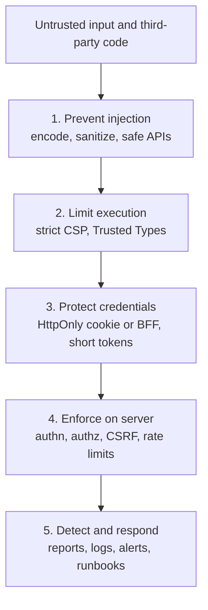
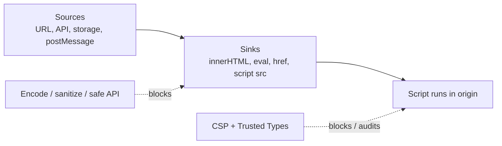
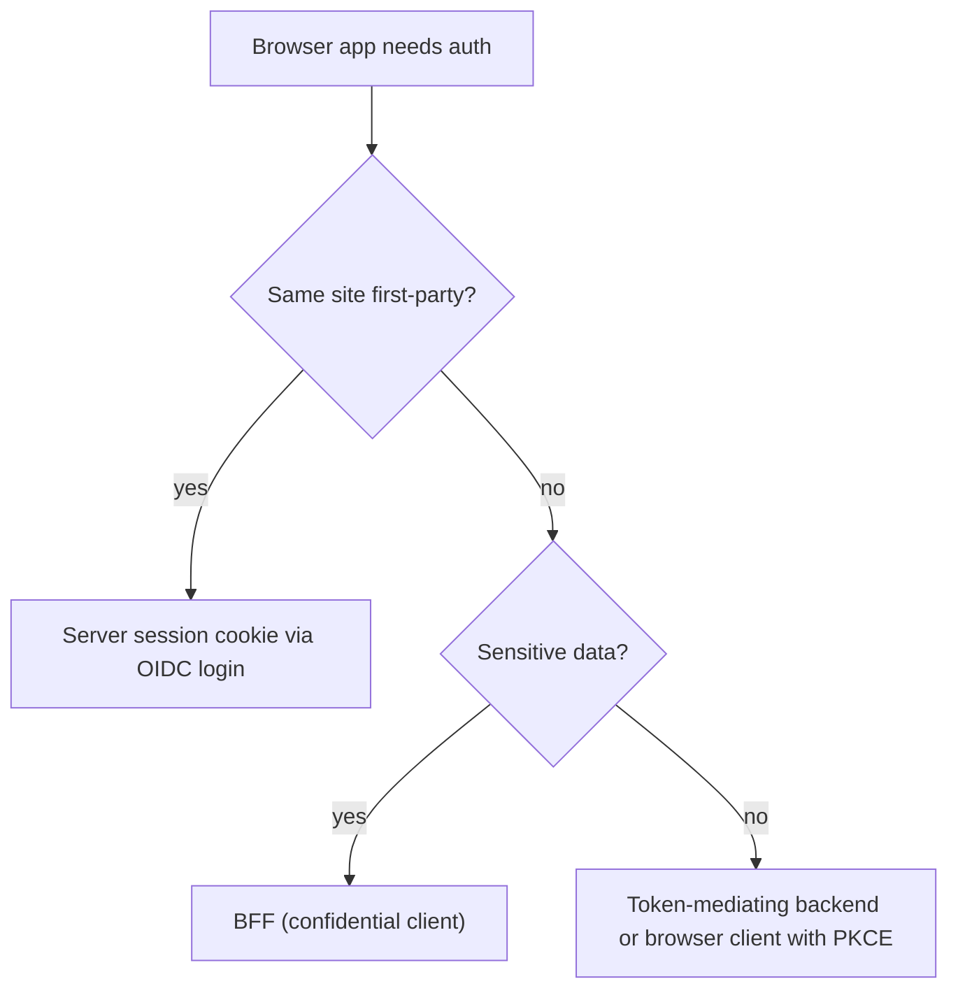
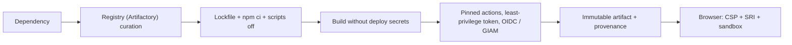

# Web Security — Recall Map (Last-Minute Read)

> One-page mental model for the whole `web-security/` folder. Verified facts (OWASP Top 10:2025 list, CSP rules, cookie attribute rules, IETF RFC 10017 browser-OAuth guidance, Sanitizer API support) come from sources checked in Nov 2026 (OWASP, MDN, IETF datatracker); items marked *(hedged)* in the full files are general knowledge. Open the full file only for topics where you're weak.
> Full docs: [01 Threat model and OWASP](01-frontend-threat-model-and-owasp-top-10.md) · [02 XSS, Trusted Types, sanitisation](02-xss-trusted-types-and-sanitization.md) · [03 CSP in depth](03-content-security-policy-in-depth.md) · [04 Cookies, sessions, CSRF](04-cookies-sessions-and-csrf.md) · [05 Authentication and authorization](05-authentication-and-authorization-in-the-frontend.md) · [06 Headers, CORS, transport](06-security-headers-cors-and-transport.md) · [07 Supply chain and third-party scripts](07-supply-chain-and-third-party-script-security.md) · [08 Secure patterns and vulnerability catalogue](08-secure-frontend-patterns-and-vulnerability-catalogue.md)

## Table of Contents

1. [The 60-Second Mental Model](#1-the-60-second-mental-model)
2. [OWASP Top 10:2025 in One Glance](#2-owasp-top-102025-in-one-glance)
3. [XSS Map](#3-xss-map)
4. [CSP Map](#4-csp-map)
5. [Session, Cookie and CSRF Map](#5-session-cookie-and-csrf-map)
6. [Auth Architecture Map](#6-auth-architecture-map)
7. [Headers and CORS Map](#7-headers-and-cors-map)
8. [Supply Chain Map](#8-supply-chain-map)
9. [Vulnerability Quick Matrix](#9-vulnerability-quick-matrix)
10. [Decision Tables](#10-decision-tables)
11. [Numbers and Defaults to Remember](#11-numbers-and-defaults-to-remember)
12. [Mnemonics](#12-mnemonics)
13. [Rapid-Fire Q&A](#13-rapid-fire-qa)
14. [Say-This Scripts](#14-say-this-scripts)
15. [Red Flags and Green Flags](#15-red-flags-and-green-flags)
16. [Final 10-Minute Checklist](#16-final-10-minute-checklist)

---

## 1. The 60-Second Mental Model

> **The browser is attacker-controlled, so the server enforces. Because script running in your origin has the same privileges as your app, you (1) stop injection, (2) limit what injected script can do, (3) keep credentials out of JavaScript, and (4) keep untrusted code and content on separate origins.**



**Five questions for any security answer**
1. **What does the attacker control** (input, third-party script, dependency, another site)?
2. **Where is the trust boundary** and who enforces there?
3. **What is the sink / capability** (HTML, URL, token, request)?
4. **What is the blast radius if this layer fails?** What's the second layer?
5. **How do we detect and recover?**

---

## 2. OWASP Top 10:2025 in One Glance

| # | Category | Frontend hook |
|---|---|---|
| A01 | Broken Access Control | IDOR, Server Action authz, UI-only checks |
| A02 | Security Misconfiguration | Headers, CORS, CSP, source maps |
| A03 | Software Supply Chain Failures | npm, CI, CDN scripts |
| A04 | Cryptographic Failures | HTTP, secrets in bundle, tokens in URLs |
| A05 | Injection | XSS, URL/CSS injection, prototype pollution |
| A06 | Insecure Design | No threat model, logic flaws, client trust |
| A07 | Authentication Failures | Sessions, tokens, MFA, brute force |
| A08 | Software or Data Integrity Failures | SRI, CI integrity, unsigned artifacts |
| A09 | Security Logging and Alerting Failures | No CSP reports, no audit trail |
| A10 | Mishandling of Exceptional Conditions | Fail-open errors, leaky stack traces |

---

## 3. XSS Map



| Layer | Do |
|---|---|
| **Render** | JSX text / `textContent`; no raw HTML |
| **HTML you must render** | Allow-list sanitiser (DOMPurify; `setHTML()` where supported) |
| **URLs** | Parse, allow `https:`/`mailto:`, never `javascript:` |
| **SSR state** | Escape `<`/line separators or use framework serialisation |
| **Backstop** | Nonce/hash CSP + Trusted Types |
| **Blast radius** | HttpOnly cookie / BFF; separate origin for user content |

**Sanitizer API:** `setHTML()` safe, `setHTMLUnsafe()` not; Chrome/Edge 146, Firefox 148, **no Safari** → not Baseline.

---

## 4. CSP Map

```http
Content-Security-Policy:
  script-src 'nonce-{RANDOM}' 'strict-dynamic';
  object-src 'none';
  base-uri 'none';
  frame-ancestors 'none';
  report-to csp-endpoint
```
- **Nonce:** new per response, unpredictable, templated into **your** tags only; no static caching. **Hash:** for static/CSR; external scripts need `integrity`.
- Nonce/hash present ⇒ `'unsafe-inline'` ignored; `'unsafe-eval'` **still** works.
- **`strict-dynamic`:** trusted scripts may load more scripts (tag managers) — less strict.
- Allow-lists are fragile (JSONP/CDN gadgets).
- **Rollout:** Report-Only + `report-to` → fix → enforce; both headers can coexist.
- **Meta tag:** limited, no report-only, no `frame-ancestors`.
- `upgrade-insecure-requests` ≠ HSTS.

---

## 5. Session, Cookie and CSRF Map

```http
Set-Cookie: __Host-Http-session=…; Secure; HttpOnly; Path=/; SameSite=Lax
```
| Fact | Value |
|---|---|
| No `SameSite` attribute | Treated as **Lax** |
| `SameSite=None` | Requires **Secure** |
| `__Host-` | Secure, no Domain, Path=/ |
| `HttpOnly` | Stops reading, **not** in-session abuse |
| Login | Regenerate session ID (anti-fixation) |
| `Clear-Site-Data: "cookies"` | Clears registrable domain + subdomains |

**CSRF defences (layer them):** SameSite · CSRF token / signed double-submit · **custom header** (forces preflight) · Origin / `Sec-Fetch-Site` checks · no state-changing GET.
**CORS ≠ CSRF defence.** Same-site ≠ same-origin (subdomain risk).

---

## 6. Auth Architecture Map


**RFC 10017 (BCP 212, Aug 2026):**
- **Auth Code + PKCE only.** Implicit and ROPC **must not** be used.
- Patterns by security: **BFF > token-mediating backend > browser-only client**.
- XSS scenarios: single theft, persistent theft, **new-token minting via hidden iframe**, request proxying.
- BFF cookie: Secure+HttpOnly MUST; SameSite=Strict, Path=/, no Domain, `__Host-Http-` SHOULD; **CSRF defence MUST**; **outbound allow-list MUST**.
- Refresh tokens: **rotate or sender-constrain**, plus max lifetime.
- **DPoP** helps vs theft; not vs new flows or proxying.
- `localStorage` for tokens = readable by XSS.
- **AuthZ = server, object-level, default deny.** UI hiding = UX. Next.js: check in DAL/Server Actions, not only layouts/proxy.

---

## 7. Headers and CORS Map

| Header | Remember |
|---|---|
| **HSTS** | `max-age`, `includeSubDomains`, preload carefully |
| **CSP** | Strict, report-only first, all responses |
| **`nosniff`** | Respect Content-Type |
| **Referrer-Policy** | `strict-origin-when-cross-origin` baseline |
| **Permissions-Policy** | Deny by default |
| **COOP / COEP / CORP** | Isolation; COEP can break 3P embeds |
| **Cache-Control** | `private` / `no-store` for sensitive |
| **`frame-ancestors`** | Anti-clickjacking (replaces XFO) |

**CORS:** exact allow-list · credentials ⇒ specific origin (no `*`) · `Vary: Origin` · never reflect Origin blindly · never allow `null` · not an auth mechanism · preflight for non-simple requests.

---

## 8. Supply Chain Map


- Install scripts run arbitrary code → `--ignore-scripts` + allow-list.
- Dependency confusion → scoped packages + registry routing.
- Pin Actions to **SHA**; least-privilege `permissions:`; separate build/deploy; no untrusted input in `run:`.
- Third-party scripts = first-party privileges → remove, self-host + SRI, sandbox iframe, separate origin, strict CSP, tag-manager governance.
- Incident: SBOM + registry logs → contain → rotate secrets → rebuild.

---

## 9. Vulnerability Quick Matrix

| Bug | One-line fix |
|---|---|
| XSS | Encode/sanitise + CSP/Trusted Types |
| CSRF | SameSite + token/custom header |
| Open redirect | Relative-only + URL parse + allow-list |
| Clickjacking | `frame-ancestors 'none'` |
| Tabnabbing | `rel="noopener noreferrer"` |
| postMessage | Exact origin + source + schema; pin `targetOrigin` |
| Prototype pollution | Block `__proto__`/`constructor`; Map; schemas |
| DOM clobbering | No implicit globals; strip id/name |
| SSRF | Allow-list + block private IPs + timeouts |
| Upload | Separate origin + re-encode + `nosniff` |
| IDOR | Object-level authz on server |
| CORS misconfig | Exact allow-list + `Vary` |
| Secrets in bundle | Server-side; rotate |
| Fail-open | Default deny |
| CSWSH | Check `Origin` on upgrade + per-message authz |

---

## 10. Decision Tables

**Where do tokens/credentials live?**
| Situation | Choose |
|---|---|
| First-party web app | HttpOnly `__Host-` session cookie |
| Sensitive/enterprise SPA with third-party APIs | BFF |
| Must call APIs from browser | Access token in memory, refresh via backend/worker, short TTL |
| Never | `localStorage` for long-lived tokens |

**Which CSP style?**
| Situation | Choose |
|---|---|
| SSR/dynamic HTML | Nonce + `strict-dynamic` |
| Static/CSR bundle | Hash-based (+ SRI on externals) |
| Legacy with inline everywhere | Report-only first; refactor |

**How to render user HTML?**
| Need | Choose |
|---|---|
| Text | JSX / `textContent` |
| Formatting | Markdown → components |
| Raw HTML unavoidable | DOMPurify allow-list (or `setHTML()` + fallback) + CSP/TT |
| Untrusted active content | Separate origin / sandboxed iframe |

**Third-party script?**
| Option | When |
|---|---|
| Server-side / build-time | Preferred |
| Sandboxed iframe | Widgets |
| Self-host + SRI | Static versioned |
| Governed live load | Last resort |

---

## 11. Numbers and Defaults to Remember

| Topic | Value |
|---|---|
| OWASP Top 10 edition | **2025** (A03 = Software Supply Chain Failures, A10 = Mishandling of Exceptional Conditions) |
| OAuth browser BCP | **RFC 10017 / BCP 212** (Aug 2026), builds on RFC 9700 (BCP 240) |
| SameSite unset | Lax |
| Cookie size | ~4 KB each |
| Sanitizer API support | Chrome/Edge 146, Firefox 148, no Safari |
| Typical HSTS | `max-age=31536000` (1 year) *(hedged)* |
| Strict CSP skeleton | nonce/hash + `object-src 'none'` + `base-uri 'none'` |
| Report format | `application/reports+json` (Reporting API); `report-uri` deprecated |

---

## 12. Mnemonics

- **"SOUP" (layers):** **S**afe APIs → **O**utput encoding/sanitise → **U**RL validation → **P**olicy (CSP/TT).
- **"HSS-P" (cookie):** **H**ttpOnly · **S**ecure · **S**ameSite · **P**refix `__Host-`.
- **"TOCS" (CSRF layers):** **T**oken · **O**rigin check · **C**ustom header · **S**ameSite.
- **"BPP" (OAuth):** **B**FF > token-mediating > **P**ublic browser client; **PKCE** always.
- **"4 XSS scenarios" (RFC 10017):** steal once · steal forever · mint new · proxy.
- **"LAPD" (supply chain):** **L**ockfile · **A**udit/SCA · **P**in actions by SHA · **D**isable install scripts.
- **"OSS" (postMessage):** **O**rigin · **S**ource · **S**chema.
- **"A-L-I-B-I" (SSRF):** **A**llow-list · **L**ock down egress · block **I**Ps private · **B**ound time/size · **I**solate network.

---

## 13. Rapid-Fire Q&A

- **Why can't the client enforce security?** The attacker controls it; enforce server-side.
- **What makes XSS so dangerous?** Injected script has the app's privileges: reads data, calls APIs, can mint tokens.
- **React XSS escape hatches?** `dangerouslySetInnerHTML`, `javascript:` URLs, direct DOM, unsafe SSR serialisation, vulnerable libraries.
- **`setHTML` vs `innerHTML`?** Sanitises XSS-unsafe content; not Baseline (no Safari).
- **What do Trusted Types do?** Require typed objects from named policies at injection sinks.
- **Nonce vs hash?** Per-response random (needs dynamic HTML) vs content digest (static-friendly).
- **`strict-dynamic`?** Trust passes to scripts loaded by trusted scripts.
- **Is `unsafe-inline` ignored with a nonce?** Yes in that directive.
- **Where is CSP set?** Header on all responses; meta is limited.
- **Report-only?** Non-enforcing policy that sends reports; deploy first.
- **SameSite default?** Lax when unset.
- **`SameSite=None` needs?** `Secure`.
- **What does `HttpOnly` stop?** JS reading the cookie, not in-session requests.
- **Why `__Host-`?** Forces Secure, host-only, Path=/ — blocks subdomain overwrite.
- **Is CORS a CSRF defence?** No.
- **CSRF defences?** SameSite, token, custom header, Origin/Fetch Metadata, no GET mutations.
- **Session fixation fix?** New session ID on login.
- **Which OAuth flow for SPAs?** Authorization Code + PKCE.
- **Is Implicit grant allowed?** No (RFC 10017).
- **Best architecture for sensitive apps?** BFF.
- **Why not `localStorage` tokens?** XSS reads them.
- **Does DPoP fix XSS?** No — new-flow minting and proxying remain.
- **Refresh token rules?** Rotate or sender-constrain, plus max lifetime/inactivity expiry.
- **ID token vs access token?** Identity for the client vs credential for APIs.
- **JWT checks?** Signature + alg allow-list, `iss`, `aud`, `exp`.
- **IDOR fix?** Object-level authorisation server-side.
- **Next.js Server Actions?** Public POST endpoints — authn + authz inside each.
- **CORS credentials rule?** Specific origin, `Allow-Credentials`, `Vary: Origin`.
- **Open-redirect fix?** Relative-only, parse with `URL`, allow-list.
- **Clickjacking fix?** `frame-ancestors`.
- **postMessage handler rules?** Check origin, source, schema.
- **Prototype pollution fix?** Block proto keys, Map/null-proto, validate.
- **SSRF fix?** Allow-list, block private ranges, timeouts, isolation.
- **Upload safety?** Separate origin, re-encode, `nosniff`.
- **Supply-chain basics?** Lockfile, `npm ci`, scripts off, SCA, pinned SHAs, least privilege.
- **SRI limits?** Static files only; needs CORS.
- **Tag manager risk?** Anyone who can publish can run script in production.
- **A10 (2025)?** Mishandling of exceptional conditions → fail closed.

---

## 14. Say-This Scripts

**"How do you secure a React SPA?"** "I start with a threat model. Render safely — JSX text, no raw HTML, sanitise with an allow-list if unavoidable — and add a strict nonce-based CSP with Trusted Types as a backstop. I keep credentials out of JavaScript: a BFF with an HttpOnly `__Host-` cookie, CSRF protection and server-side authorisation on every endpoint. I harden headers, govern third-party scripts and dependencies, and wire up CSP reporting and incident runbooks."

**"Where do you store tokens?"** "Ideally nowhere in the browser — a BFF holds them and the browser only has an HttpOnly cookie. RFC 10017 ranks BFF above a token-mediating backend and above a browser-only client, because XSS can steal tokens, keep stealing refreshed ones, mint new ones via a hidden iframe flow, or proxy requests. DPoP and rotation help but don't stop the last two."

**"CORS vs CSRF?"** "CORS governs whether scripts can read cross-origin responses. CSRF abuses ambient cookies on requests that are sent anyway. So CORS isn't a CSRF defence — I use SameSite, tokens or a custom header that forces a preflight, and Origin/Fetch-Metadata checks."

**"Roll out CSP?"** "Report-only first with a reporting endpoint, triage violations, move to nonce or hash plus `strict-dynamic`, remove inline handlers, then enforce progressively and keep a stricter candidate in report-only. Allow-lists are fragile; nonces need dynamic HTML, so static sites use hashes."

**"Supply-chain controls?"** "Registry through Artifactory, lockfile and `npm ci`, install scripts disabled with an allow-list, SCA with SLAs, release-age gates, pinned Action SHAs, least-privilege tokens and OIDC, separate build and deploy, immutable signed artifacts with SBOM, and for runtime scripts: remove, self-host with SRI, sandbox or isolate, with strict CSP."

---

## 15. Red Flags and Green Flags

| Red flags | Green flags |
|---|---|
| "CORS protects my API" | Exact allow-list, `Vary`, plus server authz/CSRF |
| Tokens in `localStorage` | BFF + HttpOnly cookie |
| `dangerouslySetInnerHTML` with API data | Wrapper with sanitiser, tests, CSP/TT |
| `script-src 'unsafe-inline' *.cdn.com` | Nonce/hash + `strict-dynamic`, report-only rollout |
| Authz only in route guards/layouts | Server/DAL checks per object |
| `Access-Control-Allow-Origin` reflecting Origin | Fixed allow-list |
| Mutable `@main`/`@v4` actions, broad tokens | SHA-pinned actions, least privilege, OIDC |
| Marketing tags on checkout | Server-side tagging / sandboxed iframes |
| Secrets in `NEXT_PUBLIC_` | Server-only secrets, scanning, rotation |
| Fail-open error handling | Default deny, generic errors, alerts |

---

## 16. Final 10-Minute Checklist

- [ ] Can I explain why the client is untrusted and where enforcement lives?
- [ ] Can I name the OWASP Top 10:2025 items relevant to frontend (A01, A02, A03, A05, A07, A09, A10)?
- [ ] Can I describe XSS types, sinks, React escape hatches, sanitisation and Trusted Types?
- [ ] Can I write a strict CSP, explain nonce vs hash vs `strict-dynamic`, and the rollout plan?
- [ ] Can I list cookie flags, prefixes, SameSite semantics and CSRF defence layers?
- [ ] Can I explain RFC 10017's three architectures and the four XSS-vs-token scenarios?
- [ ] Can I configure CORS correctly and name the common misconfigurations?
- [ ] Can I list baseline security headers and when COEP/COOP are risky?
- [ ] Can I describe supply-chain controls for npm, CI and runtime scripts?
- [ ] Can I fix open redirect, postMessage, prototype pollution, SSRF and upload issues in code?
- [ ] Can I walk through an incident response for XSS or a compromised dependency?

Related recall maps: [Browser Internals](../browser-internals/08-browser-internals-recall-map.md) · [Next.js](../nextjs-and-rendering/09-nextjs-recall-map.md) · [React](../react/09-react-recall-map.md) · [System Design](../system-design/09-system-design-recall-map.md) · [Web Performance](../web-performance/08-web-performance-recall-map.md)
